# Restormer Fine-Tuning for Defocus-Blurred Text — Complete Report, Blur Levels 0–9

- **Project:** Scene Text Recognition System (Final Year Project, Phase 2) — recognition-aware blind deblurring of degraded text images
- **Report date:** 12 November 2026
- **Source material:** the Drive export `FinalYearProject-Phase2` (11 zip parts), the ten dataset archives `HDC2021_step0 … step9` (plus step 10), and the training notebook `FinalYearProject_Phase2_Level1.ipynb`
- **Companion files in this folder:** `PROJECT_CONTEXT.md` (compact context for a new reader or LLM), `tables/` (all numbers as CSV and Markdown), `comparisons/` (image grids), `images/` (individual full-resolution panels), `figures/` (diagrams and charts)

---

## 1. Summary

One Restormer model per blur level was fine-tuned on 150 image pairs of the HDC 2021 defocus dataset and tested on 40 held-out pairs. The same notebook, hyper-parameters and image split were used at every level; only the blur level changed.

| Level | σ est. (px) | PSNR blurred | PSNR fine-tuned | Δ PSNR | SSIM blurred | SSIM fine-tuned | Δ SSIM | Char acc blurred % | Char acc fine-tuned % | Char acc sharp GT % | Δ char acc (pts) |
|--:|--:|--:|--:|--:|--:|--:|--:|--:|--:|--:|--:|
| 0 | 5 | 26.08 | 28.74 | +2.66 | 0.5236 | 0.6908 | +0.167 | — | — | — | — |
| 1 | 5 | 23.17 | 28.87 | +5.70 | 0.4193 | 0.6265 | +0.207 | 98.4 | 92.6 | 90.8 | -5.7 |
| 2 | 5 | 19.37 | 27.38 | +8.01 | 0.3902 | 0.6151 | +0.225 | 94.2 | 96.1 | 92.2 | +1.8 |
| 3 | 12 | 17.34 | 25.72 | +8.38 | 0.3795 | 0.6056 | +0.226 | 75.5 | 98.3 | 92.5 | +22.7 |
| 4 | 20 | 16.07 | 24.10 | +8.03 | 0.3730 | 0.5949 | +0.222 | 23.5 | 97.4 | 91.3 | +73.9 |
| 5 | 25 | 15.35 | 21.98 | +6.63 | 0.3724 | 0.5824 | +0.210 | 0.0 | 96.9 | 94.1 | +96.9 |
| 6 | 30 | 15.03 | 20.19 | +5.16 | 0.3723 | 0.5693 | +0.197 | 0.0 | 83.2 | 93.4 | +83.2 |
| 7 | 37 | 14.71 | 19.87 | +5.16 | 0.3729 | 0.5665 | +0.194 | 0.0 | 77.0 | 91.6 | +77.0 |
| 8 | 45 | 14.45 | 19.47 | +5.02 | 0.4173 | 0.5629 | +0.146 | 0.0 | 73.5 | 92.6 | +73.5 |
| 9 | 47 | 14.39 | 16.81 | +2.42 | 0.4192 | 0.5310 | +0.112 | 0.0 | 52.8 | 93.2 | +52.8 |

*Level 0 has no OCR results in the export; its PSNR/SSIM were recomputed for this report (§8.1). σ = 5 px is the minimum of the search grid. "Sharp GT" is EasyOCR run on the registered ground-truth image.*

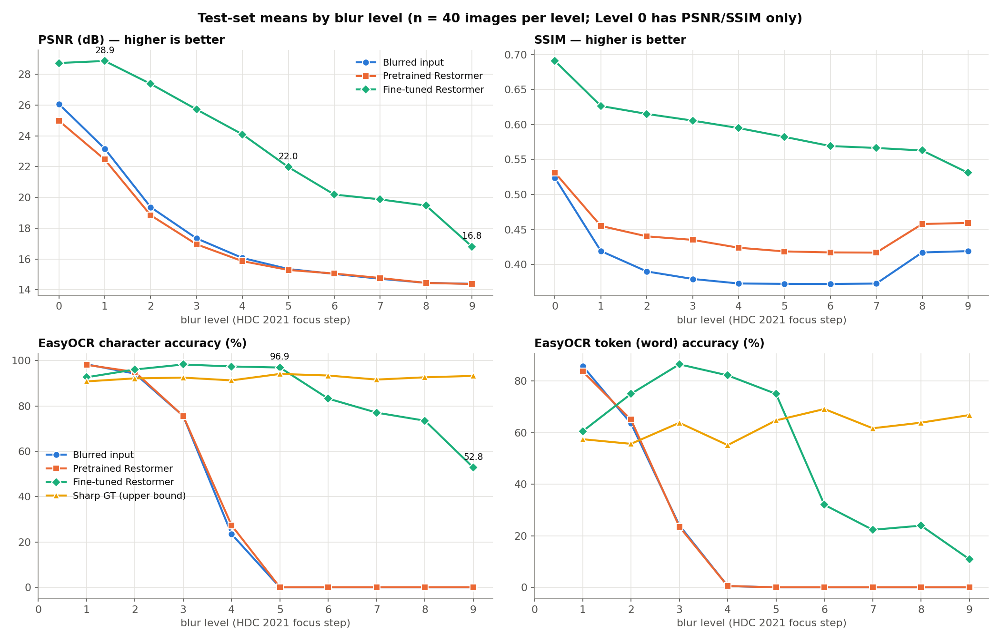

**Main findings**

1. **Fine-tuning improves image quality at every level.** PSNR gains over the blurred input range from +2.42 dB (Level 9) to +8.38 dB (Level 3); SSIM gains from +0.112 to +0.226. All 400 test images (40 × 10 levels) improve on both PSNR and SSIM.
2. **The pretrained Restormer does not help on this data.** Without fine-tuning its PSNR is never more than 0.05 dB above the blurred input and is up to 1.1 dB below it (Levels 0–5), and its OCR accuracy stays within 4 points of the blurred input. The gain comes from fine-tuning, not from the architecture alone.
3. **OCR benefit depends on the level.** At Level 1 restoration lowers character accuracy (98.4% → 92.6%) because the input is already readable. From Level 2 upward it helps, and from Level 5 upward EasyOCR finds no text at all in the blurred input while the restored images are read at 96.9% (Level 5), 83.2% (6), 77.0% (7), 73.5% (8) and 52.8% (9) character accuracy.
4. **Levels 2–5 are read better than the sharp ground truth.** EasyOCR scores only 90.8–94.1% on the ground-truth images themselves, so the "upper bound" row is a reference point, not a ceiling.
5. **Serif text fails first.** From Level 6 the Times outputs lose accuracy much faster than Verdana (Level 9: 34.3% vs 71.3%).
6. **Level 9 is at the limit of this setup.** Validation metrics oscillate, the loss has not converged after 3000 iterations, registration quality is the lowest, and outputs contain strokes that are not in the ground truth.

**Status of the export.** Levels 1–9: complete (checkpoints, logs, metrics, OCR outputs, restored images). Level 0: trained and restored, but OCR/summary files are missing. Level 10: dataset present, not trained. Combined "ultimate" model (Levels 5–10): preprocessing done and training started on 20 October 2026; the export contains only a last checkpoint and no evaluation (§11).

---

## 2. What the export contains

| Item | Location in the Drive export | Notes |
|:--|:--|:--|
| Pretrained weights | `pretrained/single_image_defocus_deblurring.pth` (104.7 MB) | Official Restormer single-image defocus-deblurring weights; starting point for every level |
| Per-level folders | `level_00` … `level_10` | `checkpoints/`, `results/`, `logs/`, `manifest.json` |
| Best / last checkpoints | `level_XX/checkpoints/levelN_best.pth`, `levelN_last.pth` | Present for Levels 0–9 |
| Metrics | `results/levelN_summary.csv`, `levelN_per_image.csv`, `levelN_by_font.csv` | Levels 1–9 (Level 5 under `results/level5_results/`) |
| OCR transcripts | `results/ocr_outputs.csv` | 160 rows per level (4 methods × 40 images), Levels 1–9 |
| Restored images | `results/restored/pretrained/*.png`, `results/restored/finetuned/*.png` | 16-bit PNG, 40 + 40 per level, Levels 0–9 |
| Registration | `results/registration_affine.npy`, `results/pairing_checks.csv` | One affine per level; alignment score for all 200 pairs |
| Split | `results/split.json` | Identical image IDs at every level |
| Training history | `logs/training_history.json`, `logs/train_log.txt` | Level 5 has history only (legacy run) |
| Cross-level summary | `all_levels_summary.csv`, `all_levels_trend.png` | Levels 1–9 |
| Combined model | `ultimate_model/` | Registration cache, splits, log, `ultimate_last.pth` (418.8 MB) |
| Datasets | `HDC2021_step0.zip` … `HDC2021_step_10.zip` (≈2.5 GB each) | Downloaded separately, same folder |

---

## 3. Dataset: HDC 2021 defocus steps

The data come from the Helsinki Deblur Challenge 2021 (HDC 2021). Text targets shown on an e-ink display were photographed simultaneously by two cameras through a beam splitter: **CAM01 stays in focus (ground truth)** and **CAM02 is progressively defocused (input)**. Each "focus step" is one fixed amount of defocus; a higher step means more blur.

Facts verified directly from the archives used here:

- Each step archive holds `stepN/Times/CAM01`, `Times/CAM02`, `Verdana/CAM01`, `Verdana/CAM02` with **100 samples per font per camera** → 200 sharp/blurred pairs per level.
- Files are named `focusStep_N_<timesR|verdanaRef>_size_30_sample_XXXX.tif`; each has a `.txt` file with the true text.
- Images are single-channel TIFFs of **2360 × 1460 px**. After registration and a 48 px border trim the working size is **2264 × 1364 px**.
- Each image shows three lines of random upper/lower-case letters (about 30 characters). The text is random, so a language model cannot guess it; the recogniser has to read every glyph.
- Each folder also ships point-target and line-target images (`focusStep_N_PSF.tif`, `_LSF_X.tif`, `_LSF_Y.tif`). The point targets below show how the blur disc grows with the step.

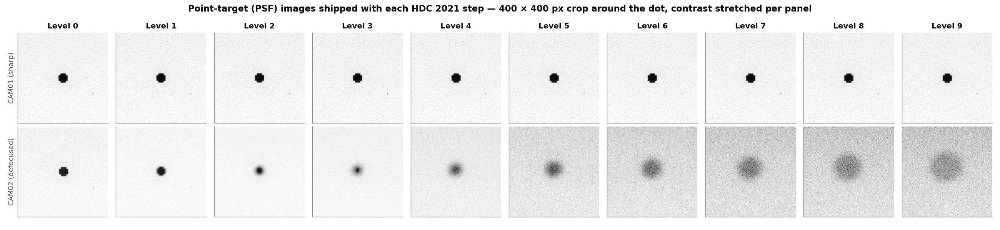

The blur is real optical defocus (a disc-like kernel plus sensor noise and a small change of magnification), not a synthetic Gaussian. The two cameras are also not pixel-aligned, which is why registration (§5.4) is needed before any pixel-wise loss or metric can be used.

---

## 4. The Restormer architecture

Restormer (Zamir et al., "Restormer: Efficient Transformer for High-Resolution Image Restoration", CVPR 2022) is an encoder–decoder Transformer built for image restoration at full resolution. This project uses the authors' **single-image defocus-deblurring configuration** unchanged, loaded from the official repository file `basicsr/models/archs/restormer_arch.py`:

```python
Restormer(inp_channels=3, out_channels=3, dim=48,
          num_blocks=[4, 6, 6, 8], num_refinement_blocks=4,
          heads=[1, 2, 4, 8], ffn_expansion_factor=2.66,
          bias=False, LayerNorm_type='WithBias', dual_pixel_task=False)
```

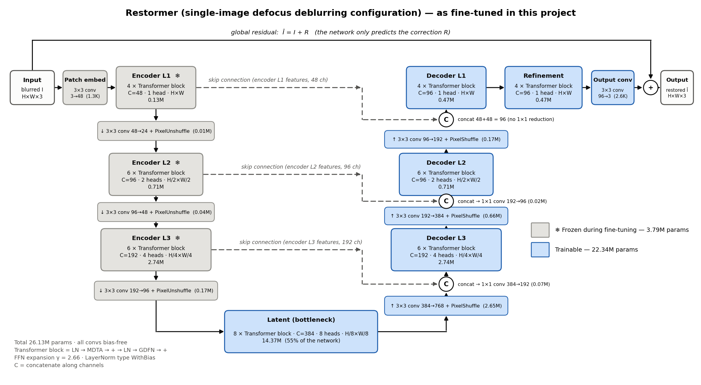

### 4.1 Overall data flow

1. **Input.** A blurred image `I` of size H × W × 3. The text images are grayscale, so the single channel is copied three times to match the pretrained weights.
2. **Overlapping patch embedding.** One 3 × 3 convolution maps 3 → 48 channels at full resolution. Unlike ViT there is no 16 × 16 patch cutting; every pixel keeps its own feature vector, which preserves thin strokes.
3. **Encoder, three levels.** Level 1: 4 Transformer blocks at 48 channels, full resolution. Level 2: 6 blocks at 96 channels, half resolution. Level 3: 6 blocks at 192 channels, quarter resolution. Between levels a 3 × 3 convolution halves the channel count and `PixelUnshuffle(2)` folds each 2 × 2 neighbourhood into channels, so resolution halves and channels double without discarding any values.
4. **Latent (bottleneck).** 8 Transformer blocks at 384 channels and 1/8 resolution. This is where the receptive field is largest and where 55% of all parameters sit.
5. **Decoder, three levels.** Each step upsamples with a 3 × 3 convolution followed by `PixelShuffle(2)`, concatenates the encoder features of the same resolution (skip connection), and — at Levels 3 and 2 — reduces the doubled channel count with a 1 × 1 convolution before 6 Transformer blocks. At Level 1 the concatenated 96 channels are kept (no reduction) and passed through 4 blocks.
6. **Refinement.** 4 more Transformer blocks at full resolution and 96 channels sharpen fine detail.
7. **Output.** A 3 × 3 convolution maps 96 → 3 channels to give a residual image `R`; the result is `Î = I + R`.

*In plain words:* the encoder looks at the page from further and further away to understand how wide the blur is; the bottleneck decides what the text must have been; the decoder zooms back in, each time re-reading the encoder's notes for that zoom level so that fine positions are not lost; and the network only has to output the *correction* to add to the blurred picture, not the whole picture.

### 4.2 The Transformer block

Every one of the 44 blocks has the same structure:

```
X'    = X  + MDTA(LayerNorm(X))
X_out = X' + GDFN(LayerNorm(X'))
```

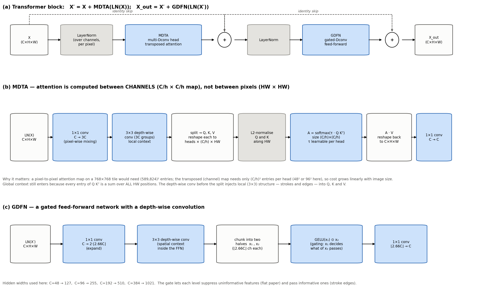

**LayerNorm (`WithBias`).** For each pixel, the feature vector across channels is normalised to zero mean and unit variance and then scaled and shifted by learned per-channel weight and bias. It is applied before each sub-layer (pre-norm), which keeps training stable in deep stacks.

**MDTA — Multi-Dconv head Transposed Attention.**

1. A 1 × 1 convolution expands C → 3C channels; a 3 × 3 depth-wise convolution then mixes each channel with its 3 × 3 neighbourhood. The result is split into query Q, key K and value V (C channels each).
2. Q, K and V are reshaped to `heads × (C/heads) × (H·W)`: each row is one channel laid out as a long vector over all pixels.
3. Q and K are L2-normalised along the pixel axis.
4. The attention map is `A = softmax(τ · Q Kᵀ)`, a `(C/heads) × (C/heads)` matrix per head, where τ is a learned temperature (one scalar per head).
5. The output is `A · V`, reshaped back to C × H × W and passed through a 1 × 1 convolution.

Standard self-attention relates every pixel to every other pixel, which needs an (H·W) × (H·W) map — impossible for megapixel images. MDTA "transposes" the problem: it relates every **channel** to every other channel. The map is tiny (48 × 48 per head in the encoder, latent and decoder levels 3 and 2; 96 × 96 in decoder level 1 and refinement), cost grows linearly with the number of pixels, and each entry of `Q Kᵀ` is still a sum over the whole image, so the block has global context. Local structure is supplied by the depth-wise convolution.

*In plain words:* instead of asking "which other pixels should this pixel look at?", the block asks "which feature detectors fire together across the whole picture?" and re-mixes the feature maps accordingly. For blur this is useful because blur is the same kind of damage everywhere on the page.

**GDFN — Gated-Dconv Feed-Forward Network.**

1. A 1 × 1 convolution expands C → 2·⌊2.66·C⌋ channels.
2. A 3 × 3 depth-wise convolution adds spatial context.
3. The tensor is split into two halves `x₁`, `x₂`; the output is `GELU(x₁) ⊙ x₂` (element-wise product).
4. A 1 × 1 convolution projects ⌊2.66·C⌋ → C.

The product acts as a gate: one half decides how much of the other half passes at each position. Flat paper regions can be suppressed while stroke edges are passed on. Hidden widths in this model are 127, 255, 510 and 1021 for C = 48, 96, 192 and 384.

### 4.3 Design details that matter for this project

- **No bias in any convolution** (`bias=False`); the only biases are in LayerNorm.
- **Pixel-(un)shuffle sampling** changes resolution by rearranging values instead of pooling or interpolating, so no stroke information is averaged away on the way down and no checkerboard-prone transposed convolutions are used on the way up.
- **Heads double with depth** (1, 2, 4, 8) so each head works on 48 channels in the encoder, latent and deeper decoder levels (96 in the single-head full-resolution decoder and refinement stages).
- **Global residual** means an untrained output layer returns the input unchanged; fine-tuning starts from "do nothing harmful".
- **Fully convolutional.** There is no positional embedding and no fixed input size, so the model trained on 128–192 px patches can be run on 768 px tiles at test time. Input height and width must be multiples of 8 (three halvings).
- **Receptive field.** Convolutions alone see a limited neighbourhood, but channel attention pools over the entire patch or tile. This is one reason patch size matters during training: with a patch smaller than the blur footprint, the global statistics the attention sees in training differ from those in a 768 px test tile.

### 4.4 Parameter budget and what is frozen

| Module (name in code) | What it is | Parameters | % of model | Fine-tuning status |
|:--|:--|--:|--:|:--|
| `patch_embed` | 3×3 conv, 3→48 | 1,296 | 0.00 | Frozen |
| `encoder_level1` | 4 blocks, C=48, 1 head, full res | 125,116 | 0.48 | Frozen |
| `down1_2` | 3×3 conv 48→24 + PixelUnshuffle(2) → 96 ch | 10,368 | 0.04 | Frozen |
| `encoder_level2` | 6 blocks, C=96, 2 heads, 1/2 res | 707,232 | 2.71 | Frozen |
| `down2_3` | 3×3 conv 96→48 + PixelUnshuffle(2) → 192 ch | 41,472 | 0.16 | Frozen |
| `encoder_level3` | 6 blocks, C=192, 4 heads, 1/4 res | 2,738,112 | 10.48 | Frozen |
| `down3_4` | 3×3 conv 192→96 + PixelUnshuffle(2) → 384 ch | 165,888 | 0.63 | Frozen |
| `latent` | 8 blocks, C=384, 8 heads, 1/8 res | 14,370,448 | 55.00 | Trainable |
| `up4_3` | 3×3 conv 384→768 + PixelShuffle(2) → 192 ch | 2,654,208 | 10.16 | Trainable |
| `reduce_chan_level3` | 1×1 conv 384→192 after concat | 73,728 | 0.28 | Trainable |
| `decoder_level3` | 6 blocks, C=192, 4 heads, 1/4 res | 2,738,112 | 10.48 | Trainable |
| `up3_2` | 3×3 conv 192→384 + PixelShuffle(2) → 96 ch | 663,552 | 2.54 | Trainable |
| `reduce_chan_level2` | 1×1 conv 192→96 after concat | 18,432 | 0.07 | Trainable |
| `decoder_level2` | 6 blocks, C=96, 2 heads, 1/2 res | 707,232 | 2.71 | Trainable |
| `up2_1` | 3×3 conv 96→192 + PixelShuffle(2) → 48 ch | 165,888 | 0.63 | Trainable |
| `decoder_level1` | 4 blocks, C=96 (48+48 concat), 1 head, full res | 471,484 | 1.80 | Trainable |
| `refinement` | 4 blocks, C=96, 1 head, full res | 471,484 | 1.80 | Trainable |
| `output` | 3×3 conv 96→3, then + input | 2,592 | 0.01 | Trainable |
| **Total** |  | **26,126,644** | 100.00 | Frozen 3,789,484 · Trainable 22,337,160 |

The counts were derived analytically from the layer definitions and reproduce the notebook's printed values exactly: total 26.13 M, frozen 3.79 M, trainable 22.34 M.

**Frozen:** `patch_embed`, `encoder_level1`, `down1_2`, `encoder_level2`, `down2_3`, `encoder_level3`, `down3_4` — the whole encoder path, 14.5% of the parameters.
**Trained:** latent, all three decoder levels, the up-sampling and channel-reduction layers, refinement and output — 85.5% of the parameters.

The reasoning behind this split: the encoder's early layers extract generic edges and blur cues that transfer from natural images, while the deeper layers decide *what the sharp content should be*, which is domain-specific (printed glyphs rather than natural scenes). Freezing the encoder also saves memory and computation on a T4 (no gradients are stored for it) and removes one source of over-fitting with only 150 training images. Note that although the encoder holds most of the *blocks at high resolution*, it holds few parameters; in parameter terms most of the network is still trained.

---

## 5. Training method (as implemented in the notebook)

The notebook is written so that only `LEVEL` changes between runs. Everything below was read from the code and confirmed against the saved logs and manifests.

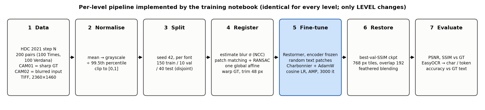

### 5.1 Environment and reproducibility

| Item | Value |
|:--|:--|
| Platform | Google Colab, Tesla T4 (15.6 GB), PyTorch 2.14.1+cu130 (as printed by the notebook) |
| Libraries | `einops`, `tifffile`, `scikit-image`, `easyocr`, `rapidfuzz`, OpenCV, pandas, matplotlib |
| Random seed | 42 for Python, NumPy and PyTorch |
| Model code | `git clone https://github.com/swz30/Restormer`; only `restormer_arch.py` is imported (avoids `basicsr` install problems) |
| Storage layout | `FinalYearProject-Phase2/level_XX/{dataset,checkpoints,results,logs}` + `manifest.json`; dataset zip copied to local disk and unzipped for speed |
| Resume | `RESUME=True` reloads `levelN_last.pth` (model, optimiser, scheduler, AMP scaler, iteration, best SSIM, history) |
| Initialisation switch | `INIT_FROM='pretrained'` (used for every level) or `'previous'` (start from the previous level's best checkpoint; not used) |

### 5.2 Loading and normalisation

- TIFFs are read as float32; multi-channel images are averaged to one channel.
- Each image is divided by its own 99.5th-percentile intensity (the paper white) and clipped to [0, 1]. This removes exposure differences between the two cameras and between samples.
- Pairs are formed by identical file names in `CAM01` and `CAM02`; a regular expression restricts files to the selected level and extracts font and sample number.
- **Sanity check:** on 10 random pairs the mean gradient energy (after a σ = 2 px smoothing so sensor noise is not counted) must be higher for CAM01 than for CAM02; otherwise the notebook stops. For Level 1 the values were 0.000514 (GT) vs 0.000256 (input).

### 5.3 Train / validation / test split

Per font, the sorted sample IDs are shuffled with seed 42; the first 20 go to test, the next 5 to validation, the remaining 75 to training → **150 train / 10 validation / 40 test**, saved to `split.json` and re-used on every run. The notebook asserts the three sets are disjoint. Because the seed and ID lists are identical, **the same sample numbers form the test set at every level** (verified across Levels 0–9), which makes levels directly comparable.

### 5.4 Registration of ground truth to input

Pixel-wise losses and PSNR/SSIM need the two cameras aligned. The notebook does this once per level:

1. **Blur-size estimate.** For 4 training pairs, the sharp image is Gaussian-blurred with σ ∈ {5, 10, …, 100} px and a 1600 × 600 px central template is matched against the real blurred image (normalised cross-correlation, ±60 px search). The σ with the highest score is kept; the median over the 4 pairs is the level's `BLUR_SIGMA`. This number is a Gaussian-equivalent size used to drive later choices, not a physical measurement.
2. **Patch matching.** On 12 training pairs, the blurred-sharp image is cut into 320 × 160 px templates on an 80 px grid (blank regions with standard deviation < 0.08 are skipped). Each is located in the real input within ±60 px; matches with NCC ≥ 0.8 are kept (relaxed to 0.7, then 0.6, if fewer than 50 survive).
3. **One global affine.** `cv2.estimateAffine2D` with RANSAC (3 px threshold, 5000 iterations) fits a single 2 × 3 affine for the level, using training images only. For Level 1: 2970 matches, 2954 inliers.
4. **Warp and trim.** Every ground-truth image is warped into the input's frame (bicubic, replicated border) and 48 px are trimmed from each edge. The input image is never resampled.
5. **Check.** For all 200 pairs the correlation between blurred-GT and input over the text area is logged before and after warping (`pairing_checks.csv`). If registration fails entirely the previous level's affine is used as a fallback (never triggered).

| Level | σ est. (px) | NCC before | NCC after | NCC after (worst pair) | Affine scale x | Affine scale y | Shift x (px) | Shift y (px) |
|--:|--:|--:|--:|--:|--:|--:|--:|--:|
| 0 | 5 | 0.897 | 0.949 | 0.938 | 0.9934 | 0.9882 | 7.1 | 13.4 |
| 1 | 5 | 0.950 | 0.970 | 0.966 | 1.0003 | 0.9951 | -0.8 | 10.3 |
| 2 | 5 | 0.906 | 0.960 | 0.953 | 1.0072 | 1.0029 | -7.8 | 6.4 |
| 3 | 12 | 0.864 | 0.948 | 0.941 | 1.0143 | 1.0097 | -14.8 | 3.8 |
| 4 | 20 | 0.824 | 0.915 | 0.905 | 1.0217 | 1.0177 | -23.1 | 0.8 |
| 5 | 25 | 0.792 | 0.892 | 0.878 | 1.0295 | 1.0245 | -32.1 | 0.4 |
| 6 | 30 | 0.758 | 0.867 | 0.849 | 1.0359 | 1.0362 | -37.1 | -8.8 |
| 7 | 37 | 0.722 | 0.836 | 0.805 | 1.0430 | 1.0373 | -48.4 | -2.9 |
| 8 | 45 | 0.669 | 0.804 | 0.755 | 1.0524 | 1.0443 | -55.9 | -4.5 |
| 9 | 47 | 0.626 | 0.780 | 0.730 | 1.0573 | 1.0524 | -68.3 | -8.5 |

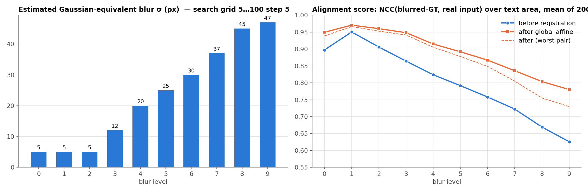

The affine scale grows steadily with the level (0.993 → 1.057 in x): defocusing changes the magnification of CAM02. Alignment quality falls as blur grows, from 0.970 at Level 1 to 0.780 at Level 9. This matters twice: mis-aligned targets blur the training signal, and they lower the PSNR/SSIM that a perfect restoration could reach.

### 5.5 Model set-up and freezing

The model is built with the configuration in §4, the pretrained weights are loaded with `strict=True`, and `requires_grad` is switched off for every parameter whose name starts with one of the seven encoder-path prefixes (§4.4). Printed by the notebook: *Frozen 3.79M | Trainable 22.34M*.

### 5.6 Patch sampling and augmentation

- A random training image and a random position are drawn; the crop is accepted only if the ground-truth patch has standard deviation > 0.05 (i.e. it contains text). Up to 20 attempts are made, so nearly every patch contains strokes rather than blank paper.
- Augmentation: random rotation by 0/90/180/270° and a horizontal flip with probability 0.5, applied identically to input and target.
- Patch size and batch follow the estimated blur: **σ ≤ 30 px → 128 px × 4; 30 < σ ≤ 50 → 192 px × 2; σ > 50 → 256 px × 2** (`PATCH_OVERRIDE` can force a size). Levels 0–6 therefore used 128 × 4 and Levels 7–9 used 192 × 2.
- Images are held in RAM as float16 (about 2.5 GB per level) and patches are cut on the fly; there is no DataLoader and no fixed epoch. 3000 iterations × batch = 12,000 patches (Levels 0–6) or 6,000 patches (Levels 7–9).

### 5.7 Optimisation

| Setting | Value |
|:--|:--|
| Loss | Charbonnier: `mean( sqrt( (Î − GT)² + ε² ) )`, ε = 1e-3 — a smooth L1 loss that is less sensitive to outliers (mis-registered pixels, sensor noise) than L2 |
| Optimiser | AdamW, learning rate 2e-5, weight decay 1e-4, betas (0.9, 0.999), trainable parameters only |
| Schedule | Cosine annealing over 3000 iterations down to 1e-7 |
| Iterations | 3000 |
| Mixed precision | `torch.autocast` float16 forward pass + `GradScaler`; the loss is computed in float32 |
| Gradient clipping | Global norm 1.0 (after un-scaling) |
| Validation | Every 500 iterations and at iteration 0, on the 10 validation images, full-image tiled inference, PSNR and SSIM |
| Model selection | Checkpoint with the highest **validation SSIM** is saved as `levelN_best.pth`; the test set is never used for selection |
| Logging | Mean loss of each 50 iterations → `training_history.json`; validation lines → `train_log.txt` |

The learning rate is deliberately small (the original Restormer training uses 3e-4) because this is fine-tuning from good weights on few images.

| Level | Run date | σ est. (px) | Patch × batch | Patches seen | Val PSNR @0 | Val SSIM @0 | Best iter | Val PSNR @best | Val SSIM @best | Loss (first 50 it) | Loss (last 50 it) | Wall time (min) |
|--:|--:|--:|--:|--:|--:|--:|--:|--:|--:|--:|--:|--:|
| 0 | 2026-11-12 | 5 | 128×128 × 4 | 12000 | 24.71 | 0.5182 | 3000 | 28.17 | 0.6800 | 0.0376 | 0.0279 | 50 |
| 1 | 2026-11-12 | 5 | 128×128 × 4 | 12000 | 22.46 | 0.4579 | 2500 | 28.83 | 0.6277 | 0.0468 | 0.0271 | 45 |
| 2 | 2026-11-12 | 5 | 128×128 × 4 | 12000 | 18.93 | 0.4393 | 3000 | 27.47 | 0.6129 | 0.0661 | 0.0307 | 44 |
| 3 | 2026-11-12 | 12 | 128×128 × 4 | 12000 | 17.03 | 0.4375 | 2000 | 25.76 | 0.6052 | 0.0966 | 0.0355 | 48 |
| 4 | 2026-11-12 | 20 | 128×128 × 4 | 12000 | 15.85 | 0.4249 | 3000 | 23.95 | 0.5939 | 0.1290 | 0.0417 | 43 |
| 5 | 2026-10 (legacy run) | 25 | 128×128 × 4 | 12000 | 15.38 | 0.4225 | 3000 | 22.01 | 0.5832 | 0.1416 | 0.0557 | — |
| 6 | 2026-10-19 | 30 | 128×128 × 4 | 12000 | 15.03 | 0.4172 | 3000 | 20.19 | 0.5684 | 0.1499 | 0.0708 | 45 |
| 7 | 2026-11-11 | 37 | 192×192 × 2 | 6000 | 14.80 | 0.4150 | 2500 | 20.02 | 0.5667 | 0.1401 | 0.0634 | 81 |
| 8 | 2026-11-11 | 45 | 192×192 × 2 | 6000 | 14.43 | 0.4577 | 3000 | 19.48 | 0.5635 | 0.1429 | 0.0748 | 88 |
| 9 | 2026-11-11 | 47 | 192×192 × 2 | 6000 | 14.38 | 0.4583 | 2000 | 16.70 | 0.5286 | 0.1377 | 0.0845 | 85 |

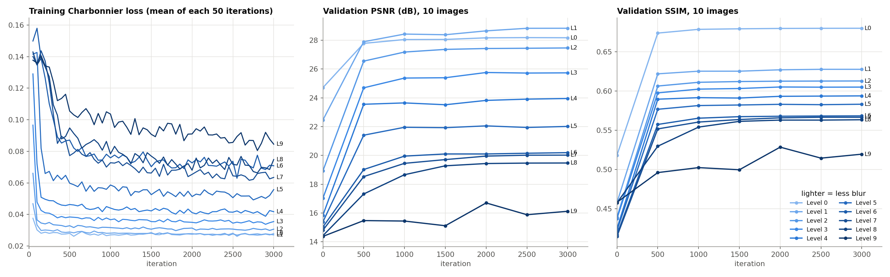

Most of the improvement arrives in the first 500 iterations at every level except 9; after that the curves flatten. The converged loss rises with the blur level (0.027 at Levels 0–1 to 0.085 at Level 9). At Level 9 the validation curve is not monotonic and the loss is still decreasing at the end.

### 5.8 Full-image inference

Test images (2264 × 1364) do not fit through the network in one pass on a T4, so `restore()` works in tiles:

- reflect-pad so height and width are multiples of 8;
- 768 × 768 px tiles with 192 px overlap (stride 576; 256 px overlap would be used for σ > 50, which no trained level reached), with the last tile in each direction snapped to the image edge;
- each tile is weighted by a separable window that ramps linearly from 0.05 to 1 over the outer 96 px, and overlapping tiles are blended by weighted average, so no seams are visible;
- the three output channels are averaged back to one channel and clipped to [0, 1];
- outputs are saved as 16-bit PNGs.

---

## 6. Evaluation method and metric definitions

Four versions of each test image are scored: **Blurred input** (CAM02), **Pretrained Restormer** (original weights, no fine-tuning — the same reference at every level), **Fine-tuned Restormer** (best-validation checkpoint of that level), and **Sharp GT** (the registered CAM01 image; OCR only).

| Metric | Definition | Source |
|:--|:--|:--|
| PSNR (dB) | `10·log10(1 / MSE)` between output and registered ground truth, data range 1.0, whole 2264 × 1364 image | Notebook (`skimage`) |
| SSIM | Structural similarity, `skimage` defaults (7 × 7 uniform window), data range 1.0, whole image | Notebook |
| Character accuracy | `max(0, 1 − Levenshtein(OCR, GT) / len(GT))` after collapsing whitespace | Notebook |
| Token accuracy | Fraction of ground-truth whitespace-separated tokens that appear in the OCR output (each OCR token can be used once; order ignored) | Notebook |
| CER | `Levenshtein(OCR, GT) / len(GT)` (not capped; equals 1 − character accuracy whenever that is ≥ 0) | Computed for this report from the saved transcripts |
| WER | Word-level Levenshtein distance / number of GT words (can exceed 100% when the OCR output has extra words) | Computed for this report |
| Mean edit distance | Average number of character edits per image (GT strings are 30–32 characters) | Computed for this report |
| Exact-match rate | Share of images whose OCR string equals the GT string exactly | Computed for this report |
| Empty-OCR rate | Share of images for which EasyOCR returned no text | Computed for this report |

**OCR procedure.** EasyOCR (`Reader(['en'], gpu=True)`, default detection and recognition models) is run on the 8-bit image with `detail=1, paragraph=False`. Detected boxes are grouped into lines by vertical position (boxes whose centres differ by less than half a box height share a line), sorted left-to-right within a line, and joined with spaces. No language model, dictionary or post-correction is used.

The character accuracies recomputed from the saved transcripts match the notebook's stored values to machine precision, and PSNR/SSIM recomputed from the saved images for four images per level match to within 0.003 dB and 0.00002 SSIM.

---

## 7. Results across levels

### 7.1 Full metric table

| Level | Method | PSNR (dB) | SSIM | Char acc % | Token acc % | CER % | WER % | Exact-match % | Empty OCR % |
|--:|:--|--:|--:|--:|--:|--:|--:|--:|--:|
| 0 | Blurred input | 26.08 | 0.5236 | — | — | — | — | — | — |
| 0 | Pretrained Restormer | 24.98 | 0.5311 | — | — | — | — | — | — |
| 0 | Fine-tuned Restormer | 28.74 | 0.6908 | — | — | — | — | — | — |
| 1 | Blurred input | 23.17 | 0.4193 | 98.35 | 85.79 | 1.65 | 15.88 | 55.0 | 0 |
| 1 | Pretrained Restormer | 22.47 | 0.4552 | 98.11 | 83.71 | 1.89 | 19.62 | 50.0 | 0 |
| 1 | Fine-tuned Restormer | 28.87 | 0.6265 | 92.62 | 60.50 | 7.38 | 56.88 | 20.0 | 0 |
| 1 | Sharp GT (upper bound) | — | — | 90.81 | 57.42 | 9.19 | 64.96 | 15.0 | 0 |
| 2 | Blurred input | 19.37 | 0.3902 | 94.25 | 63.54 | 5.75 | 42.71 | 22.5 | 0 |
| 2 | Pretrained Restormer | 18.84 | 0.4403 | 94.97 | 65.00 | 5.03 | 39.79 | 25.0 | 0 |
| 2 | Fine-tuned Restormer | 27.38 | 0.6151 | 96.07 | 75.00 | 3.93 | 27.50 | 37.5 | 0 |
| 2 | Sharp GT (upper bound) | — | — | 92.16 | 55.62 | 7.84 | 58.54 | 20.0 | 0 |
| 3 | Blurred input | 17.34 | 0.3795 | 75.55 | 24.04 | 24.45 | 88.04 | 2.5 | 0 |
| 3 | Pretrained Restormer | 16.95 | 0.4353 | 75.54 | 23.50 | 24.46 | 93.29 | 2.5 | 0 |
| 3 | Fine-tuned Restormer | 25.72 | 0.6056 | 98.28 | 86.46 | 1.72 | 14.17 | 62.5 | 0 |
| 3 | Sharp GT (upper bound) | — | — | 92.48 | 63.79 | 7.52 | 49.92 | 20.0 | 0 |
| 4 | Blurred input | 16.07 | 0.3730 | 23.48 | 0.50 | 76.52 | 130.17 | 0.0 | 0 |
| 4 | Pretrained Restormer | 15.86 | 0.4241 | 27.34 | 0.50 | 72.66 | 134.96 | 0.0 | 0 |
| 4 | Fine-tuned Restormer | 24.10 | 0.5949 | 97.40 | 82.17 | 2.60 | 17.83 | 47.5 | 0 |
| 4 | Sharp GT (upper bound) | — | — | 91.27 | 55.12 | 8.73 | 65.88 | 15.0 | 0 |
| 5 | Blurred input | 15.35 | 0.3724 | 0.00 | 0.00 | 100.00 | 100.00 | 0.0 | 100 |
| 5 | Pretrained Restormer | 15.29 | 0.4188 | 0.00 | 0.00 | 100.00 | 100.00 | 0.0 | 100 |
| 5 | Fine-tuned Restormer | 21.98 | 0.5824 | 96.94 | 75.00 | 3.06 | 25.83 | 40.0 | 0 |
| 5 | Sharp GT (upper bound) | — | — | 94.11 | 64.71 | 5.89 | 51.54 | 25.0 | 0 |
| 6 | Blurred input | 15.03 | 0.3723 | 0.00 | 0.00 | 100.00 | 100.00 | 0.0 | 100 |
| 6 | Pretrained Restormer | 15.05 | 0.4174 | 0.00 | 0.00 | 100.00 | 100.00 | 0.0 | 100 |
| 6 | Fine-tuned Restormer | 20.19 | 0.5693 | 83.22 | 32.00 | 16.78 | 78.83 | 0.0 | 0 |
| 6 | Sharp GT (upper bound) | — | — | 93.41 | 69.12 | 6.59 | 38.67 | 20.0 | 0 |
| 7 | Blurred input | 14.71 | 0.3729 | 0.00 | 0.00 | 100.00 | 100.00 | 0.0 | 100 |
| 7 | Pretrained Restormer | 14.76 | 0.4171 | 0.00 | 0.00 | 100.00 | 100.00 | 0.0 | 100 |
| 7 | Fine-tuned Restormer | 19.87 | 0.5665 | 77.04 | 22.29 | 22.96 | 98.12 | 0.0 | 0 |
| 7 | Sharp GT (upper bound) | — | — | 91.63 | 61.67 | 8.37 | 61.25 | 20.0 | 0 |
| 8 | Blurred input | 14.45 | 0.4173 | 0.00 | 0.00 | 100.00 | 100.00 | 0.0 | 100 |
| 8 | Pretrained Restormer | 14.44 | 0.4579 | 0.00 | 0.00 | 100.00 | 100.00 | 0.0 | 100 |
| 8 | Fine-tuned Restormer | 19.47 | 0.5629 | 73.47 | 23.92 | 26.53 | 98.38 | 0.0 | 0 |
| 8 | Sharp GT (upper bound) | — | — | 92.62 | 63.83 | 7.38 | 56.50 | 17.5 | 0 |
| 9 | Blurred input | 14.39 | 0.4192 | 0.00 | 0.00 | 100.00 | 100.00 | 0.0 | 100 |
| 9 | Pretrained Restormer | 14.38 | 0.4595 | 0.00 | 0.00 | 100.00 | 100.00 | 0.0 | 100 |
| 9 | Fine-tuned Restormer | 16.81 | 0.5310 | 52.82 | 10.87 | 47.18 | 133.12 | 0.0 | 0 |
| 9 | Sharp GT (upper bound) | — | — | 93.24 | 66.79 | 6.76 | 50.17 | 32.5 | 0 |

### 7.2 Gains of the fine-tuned model

| Level | Δ PSNR vs blurred | Δ SSIM vs blurred | Δ char acc vs blurred (pts) | Δ token acc vs blurred (pts) | Δ PSNR vs pretrained | Δ SSIM vs pretrained | Δ char acc vs pretrained (pts) | Images with PSNR gain | Images with SSIM gain | Char acc win / tie / loss vs blurred | Fine-tuned − sharp-GT char acc (pts) |
|--:|--:|--:|--:|--:|--:|--:|--:|--:|--:|--:|--:|
| 0 | +2.66 | +0.1672 | — | — | +3.75 | +0.1596 | — | 40/40 | 40/40 | — | — |
| 1 | +5.70 | +0.2072 | -5.7 | -25.3 | +6.40 | +0.1713 | -5.5 | 40/40 | 40/40 | 1 / 11 / 28 | +1.8 |
| 2 | +8.01 | +0.2249 | +1.8 | +11.5 | +8.54 | +0.1748 | +1.1 | 40/40 | 40/40 | 18 / 17 / 5 | +3.9 |
| 3 | +8.38 | +0.2261 | +22.7 | +62.4 | +8.77 | +0.1703 | +22.7 | 40/40 | 40/40 | 38 / 2 / 0 | +5.8 |
| 4 | +8.03 | +0.2220 | +73.9 | +81.7 | +8.24 | +0.1709 | +70.1 | 40/40 | 40/40 | 40 / 0 / 0 | +6.1 |
| 5 | +6.63 | +0.2099 | +96.9 | +75.0 | +6.69 | +0.1636 | +96.9 | 40/40 | 40/40 | 40 / 0 / 0 | +2.8 |
| 6 | +5.16 | +0.1970 | +83.2 | +32.0 | +5.14 | +0.1519 | +83.2 | 40/40 | 40/40 | 40 / 0 / 0 | -10.2 |
| 7 | +5.16 | +0.1936 | +77.0 | +22.3 | +5.11 | +0.1494 | +77.0 | 40/40 | 40/40 | 40 / 0 / 0 | -14.6 |
| 8 | +5.02 | +0.1456 | +73.5 | +23.9 | +5.03 | +0.1050 | +73.5 | 40/40 | 40/40 | 40 / 0 / 0 | -19.1 |
| 9 | +2.42 | +0.1118 | +52.8 | +10.9 | +2.43 | +0.0715 | +52.8 | 40/40 | 40/40 | 40 / 0 / 0 | -40.4 |

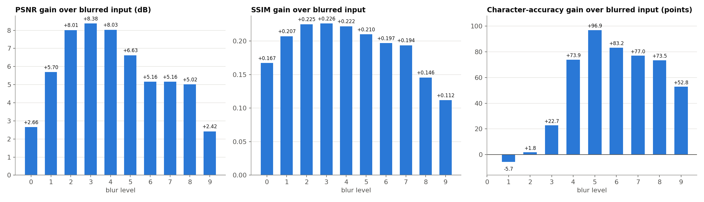

### 7.3 By font

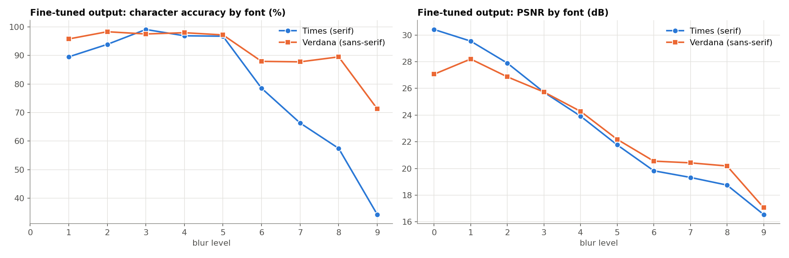

| Level | Method | Font | PSNR (dB) | SSIM | Char acc % | Token acc % | CER % | WER % |
|--:|:--|:--|--:|--:|--:|--:|--:|--:|
| 0 | Blurred input | timesR | 27.11 | 0.5663 | — | — | — | — |
| 0 | Blurred input | verdanaRef | 25.05 | 0.4809 | — | — | — | — |
| 0 | Pretrained Restormer | timesR | 25.58 | 0.5606 | — | — | — | — |
| 0 | Pretrained Restormer | verdanaRef | 24.39 | 0.5017 | — | — | — | — |
| 0 | Fine-tuned Restormer | timesR | 30.41 | 0.7180 | — | — | — | — |
| 0 | Fine-tuned Restormer | verdanaRef | 27.06 | 0.6635 | — | — | — | — |
| 1 | Blurred input | timesR | 23.12 | 0.4251 | 98.44 | 86.17 | 1.56 | 17.17 |
| 1 | Blurred input | verdanaRef | 23.22 | 0.4136 | 98.27 | 85.42 | 1.73 | 14.58 |
| 1 | Pretrained Restormer | timesR | 22.39 | 0.4600 | 97.96 | 82.00 | 2.04 | 24.67 |
| 1 | Pretrained Restormer | verdanaRef | 22.54 | 0.4504 | 98.27 | 85.42 | 1.73 | 14.58 |
| 1 | Fine-tuned Restormer | timesR | 29.54 | 0.6327 | 89.49 | 51.75 | 10.51 | 77.83 |
| 1 | Fine-tuned Restormer | verdanaRef | 28.20 | 0.6202 | 95.75 | 69.25 | 4.25 | 35.92 |
| 1 | Sharp GT (upper bound) | timesR | — | — | 87.27 | 45.58 | 12.73 | 88.58 |
| 1 | Sharp GT (upper bound) | verdanaRef | — | — | 94.35 | 69.25 | 5.65 | 41.33 |
| 2 | Blurred input | timesR | 19.21 | 0.3943 | 90.53 | 45.83 | 9.47 | 66.67 |
| 2 | Blurred input | verdanaRef | 19.52 | 0.3861 | 97.97 | 81.25 | 2.03 | 18.75 |
| 2 | Pretrained Restormer | timesR | 18.73 | 0.4450 | 91.81 | 47.50 | 8.19 | 62.08 |
| 2 | Pretrained Restormer | verdanaRef | 18.96 | 0.4356 | 98.12 | 82.50 | 1.88 | 17.50 |
| 2 | Fine-tuned Restormer | timesR | 27.90 | 0.6214 | 93.85 | 65.83 | 6.15 | 39.17 |
| 2 | Fine-tuned Restormer | verdanaRef | 26.86 | 0.6089 | 98.28 | 84.17 | 1.72 | 15.83 |
| 2 | Sharp GT (upper bound) | timesR | — | — | 88.69 | 42.50 | 11.31 | 84.17 |
| 2 | Sharp GT (upper bound) | verdanaRef | — | — | 95.62 | 68.75 | 4.38 | 32.92 |
| 3 | Blurred input | timesR | 17.39 | 0.3831 | 60.18 | 3.00 | 39.82 | 119.50 |
| 3 | Blurred input | verdanaRef | 17.28 | 0.3759 | 90.92 | 45.08 | 9.08 | 56.58 |
| 3 | Pretrained Restormer | timesR | 17.05 | 0.4382 | 60.64 | 6.50 | 39.36 | 125.42 |
| 3 | Pretrained Restormer | verdanaRef | 16.86 | 0.4324 | 90.44 | 40.50 | 9.56 | 61.17 |
| 3 | Fine-tuned Restormer | timesR | 25.71 | 0.6092 | 99.06 | 92.75 | 0.94 | 8.50 |
| 3 | Fine-tuned Restormer | verdanaRef | 25.73 | 0.6020 | 97.49 | 80.17 | 2.51 | 19.83 |
| 3 | Sharp GT (upper bound) | timesR | — | — | 89.80 | 55.58 | 10.20 | 67.92 |
| 3 | Sharp GT (upper bound) | verdanaRef | — | — | 95.15 | 72.00 | 4.85 | 31.92 |
| 4 | Blurred input | timesR | 16.30 | 0.3778 | 14.59 | 0.00 | 85.41 | 117.67 |
| 4 | Blurred input | verdanaRef | 15.83 | 0.3682 | 32.36 | 1.00 | 67.64 | 142.67 |
| 4 | Pretrained Restormer | timesR | 16.11 | 0.4286 | 18.07 | 0.00 | 81.93 | 125.08 |
| 4 | Pretrained Restormer | verdanaRef | 15.61 | 0.4196 | 36.60 | 1.00 | 63.40 | 144.83 |
| 4 | Fine-tuned Restormer | timesR | 23.92 | 0.5962 | 96.86 | 79.67 | 3.14 | 20.33 |
| 4 | Fine-tuned Restormer | verdanaRef | 24.28 | 0.5937 | 97.93 | 84.67 | 2.07 | 15.33 |
| 4 | Sharp GT (upper bound) | timesR | — | — | 88.54 | 44.42 | 11.46 | 86.75 |
| 4 | Sharp GT (upper bound) | verdanaRef | — | — | 93.99 | 65.83 | 6.01 | 45.00 |
| 5 | Blurred input | timesR | 15.58 | 0.3780 | 0.00 | 0.00 | 100.00 | 100.00 |
| 5 | Blurred input | verdanaRef | 15.12 | 0.3669 | 0.00 | 0.00 | 100.00 | 100.00 |
| 5 | Pretrained Restormer | timesR | 15.53 | 0.4243 | 0.00 | 0.00 | 100.00 | 100.00 |
| 5 | Pretrained Restormer | verdanaRef | 15.04 | 0.4133 | 0.00 | 0.00 | 100.00 | 100.00 |
| 5 | Fine-tuned Restormer | timesR | 21.77 | 0.5839 | 96.71 | 73.25 | 3.29 | 26.75 |
| 5 | Fine-tuned Restormer | verdanaRef | 22.18 | 0.5809 | 97.16 | 76.75 | 2.84 | 24.92 |
| 5 | Sharp GT (upper bound) | timesR | — | — | 92.15 | 58.08 | 7.85 | 66.92 |
| 5 | Sharp GT (upper bound) | verdanaRef | — | — | 96.07 | 71.33 | 3.93 | 36.17 |
| 6 | Blurred input | timesR | 15.32 | 0.3766 | 0.00 | 0.00 | 100.00 | 100.00 |
| 6 | Blurred input | verdanaRef | 14.75 | 0.3680 | 0.00 | 0.00 | 100.00 | 100.00 |
| 6 | Pretrained Restormer | timesR | 15.35 | 0.4220 | 0.00 | 0.00 | 100.00 | 100.00 |
| 6 | Pretrained Restormer | verdanaRef | 14.75 | 0.4127 | 0.00 | 0.00 | 100.00 | 100.00 |
| 6 | Fine-tuned Restormer | timesR | 19.83 | 0.5683 | 78.52 | 23.92 | 21.48 | 92.75 |
| 6 | Fine-tuned Restormer | verdanaRef | 20.55 | 0.5703 | 87.91 | 40.08 | 12.09 | 64.92 |
| 6 | Sharp GT (upper bound) | timesR | — | — | 91.69 | 66.42 | 8.31 | 44.58 |
| 6 | Sharp GT (upper bound) | verdanaRef | — | — | 95.12 | 71.83 | 4.88 | 32.75 |
| 7 | Blurred input | timesR | 14.93 | 0.3751 | 0.00 | 0.00 | 100.00 | 100.00 |
| 7 | Blurred input | verdanaRef | 14.50 | 0.3707 | 0.00 | 0.00 | 100.00 | 100.00 |
| 7 | Pretrained Restormer | timesR | 14.99 | 0.4192 | 0.00 | 0.00 | 100.00 | 100.00 |
| 7 | Pretrained Restormer | verdanaRef | 14.54 | 0.4149 | 0.00 | 0.00 | 100.00 | 100.00 |
| 7 | Fine-tuned Restormer | timesR | 19.33 | 0.5631 | 66.34 | 5.42 | 33.66 | 130.00 |
| 7 | Fine-tuned Restormer | verdanaRef | 20.42 | 0.5699 | 87.74 | 39.17 | 12.26 | 66.25 |
| 7 | Sharp GT (upper bound) | timesR | — | — | 87.95 | 53.33 | 12.05 | 86.25 |
| 7 | Sharp GT (upper bound) | verdanaRef | — | — | 95.30 | 70.00 | 4.70 | 36.25 |
| 8 | Blurred input | timesR | 14.66 | 0.4199 | 0.00 | 0.00 | 100.00 | 100.00 |
| 8 | Blurred input | verdanaRef | 14.24 | 0.4147 | 0.00 | 0.00 | 100.00 | 100.00 |
| 8 | Pretrained Restormer | timesR | 14.65 | 0.4604 | 0.00 | 0.00 | 100.00 | 100.00 |
| 8 | Pretrained Restormer | verdanaRef | 14.23 | 0.4554 | 0.00 | 0.00 | 100.00 | 100.00 |
| 8 | Fine-tuned Restormer | timesR | 18.75 | 0.5589 | 57.47 | 8.50 | 42.53 | 129.42 |
| 8 | Fine-tuned Restormer | verdanaRef | 20.19 | 0.5669 | 89.48 | 39.33 | 10.52 | 67.33 |
| 8 | Sharp GT (upper bound) | timesR | — | — | 91.37 | 60.17 | 8.63 | 70.83 |
| 8 | Sharp GT (upper bound) | verdanaRef | — | — | 93.88 | 67.50 | 6.12 | 42.17 |
| 9 | Blurred input | timesR | 14.60 | 0.4216 | 0.00 | 0.00 | 100.00 | 100.00 |
| 9 | Blurred input | verdanaRef | 14.17 | 0.4168 | 0.00 | 0.00 | 100.00 | 100.00 |
| 9 | Pretrained Restormer | timesR | 14.59 | 0.4619 | 0.00 | 0.00 | 100.00 | 100.00 |
| 9 | Pretrained Restormer | verdanaRef | 14.17 | 0.4571 | 0.00 | 0.00 | 100.00 | 100.00 |
| 9 | Fine-tuned Restormer | timesR | 16.55 | 0.5299 | 34.33 | 3.25 | 65.67 | 160.83 |
| 9 | Fine-tuned Restormer | verdanaRef | 17.06 | 0.5320 | 71.30 | 18.50 | 28.70 | 105.42 |
| 9 | Sharp GT (upper bound) | timesR | — | — | 90.26 | 54.08 | 9.74 | 74.67 |
| 9 | Sharp GT (upper bound) | verdanaRef | — | — | 96.22 | 79.50 | 3.78 | 25.67 |

### 7.4 Spread across images

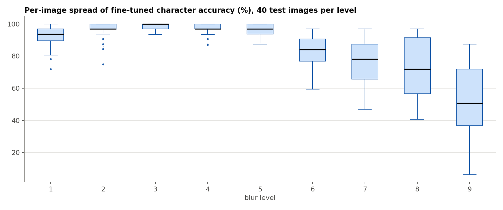

For Levels 2–5 nearly all images sit above 90%. From Level 6 the spread widens sharply (standard deviation 8.8 points at Level 6, 21.9 points at Level 9), which is mostly the Times/Verdana split shown above.

---

## 8. Level-by-level report

Each sub-section gives the configuration, validation trajectory, test metrics, font breakdown, the image comparison (blurred | fine-tuned | ground truth) with per-image scores and OCR output, and observations.


### 8.1 Level 0

| Item | Value |
|:--|:--|
| Dataset archive | `HDC2021_step0.zip` — 200 pairs (100 Times, 100 Verdana) |
| Split (same image IDs at every level) | 150 train / 10 validation / 40 test |
| Estimated blur σ | 5 px (grid minimum — treat as "≤ 5 px") |
| Registration alignment score (NCC) | 0.897 before → 0.949 after (worst pair 0.938) |
| Global affine (input → GT) | scale x 0.9934, scale y 0.9882, shift (7.1, 13.4) px |
| Initial weights | Original pretrained Restormer (`single_image_defocus_deblurring.pth`); no curriculum from other levels |
| Training patch × batch | 128 px × 4 |
| Iterations / learning rate | 3000 / 2e-5 (cosine decay to 1e-7) |
| Inference tiling | 768 px tiles, 192 px overlap |
| Best checkpoint | iteration 3000 — validation 28.17 dB / SSIM 0.6800 |
| Run date / wall time | 2026-11-12 / 50 min on a Tesla T4 |
| Checkpoints | `level_00/checkpoints/level0_best.pth` (104.7 MB, weights only), `level0_last.pth` (283.7 MB, with optimiser state) |


**Validation during training** (10 held-out images, full-image tiled inference)

| Iteration | 0 | 500 | 1000 | 1500 | 2000 | 2500 | 3000 |
|:--|--:|--:|--:|--:|--:|--:|--:|
| PSNR (dB) | 24.71 | 27.78 | 28.05 | 28.06 | 28.17 | 28.18 | 28.17 |
| SSIM | 0.5182 | 0.6738 | 0.6786 | 0.6793 | 0.6797 | 0.6799 | 0.6800 |


**Test-set results** (n = 40; mean ± standard deviation across images)

| Method | PSNR (dB) | SSIM | Char acc % | Char acc range % | Token acc % | CER % | WER % | Mean edit distance | Exact-match % | Empty OCR % |
|:--|--:|--:|--:|--:|--:|--:|--:|--:|--:|--:|
| Blurred input | 26.08 ± 1.33 | 0.5236 ± 0.0557 | — | — | — | — | — | — | — | — |
| Pretrained Restormer | 24.98 ± 0.87 | 0.5311 ± 0.0437 | — | — | — | — | — | — | — | — |
| Fine-tuned Restormer | 28.74 ± 2.20 | 0.6908 ± 0.0347 | — | — | — | — | — | — | — | — |


Fine-tuned vs blurred input: **+2.66 dB PSNR, +0.1672 SSIM.** Fine-tuned vs pretrained: +3.75 dB, +0.1596 SSIM. PSNR improved on 40/40 images, SSIM on 40/40.

**By font**

| L | Method | Font | PSNR (dB) | SSIM | Char acc % | Token acc % | CER % | WER % |
|--:|:--|:--|--:|--:|--:|--:|--:|--:|
| 0 | Blurred input | timesR | 27.11 | 0.5663 | — | — | — | — |
| 0 | Blurred input | verdanaRef | 25.05 | 0.4809 | — | — | — | — |
| 0 | Pretrained Restormer | timesR | 25.58 | 0.5606 | — | — | — | — |
| 0 | Pretrained Restormer | verdanaRef | 24.39 | 0.5017 | — | — | — | — |
| 0 | Fine-tuned Restormer | timesR | 30.41 | 0.7180 | — | — | — | — |
| 0 | Fine-tuned Restormer | verdanaRef | 27.06 | 0.6635 | — | — | — | — |


**Image comparison — blurred (left), fine-tuned (middle), ground truth (right)**

The four images are test-split positions 1, 11, 21 and 31 (two Times, two Verdana), chosen by position rather than by result. The same four image IDs are shown at every level.

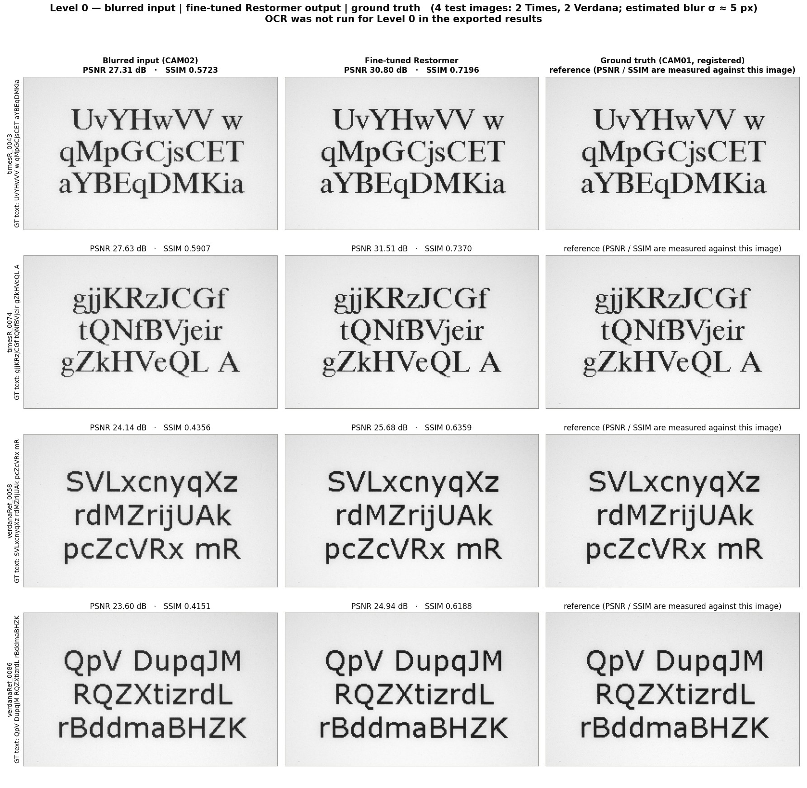

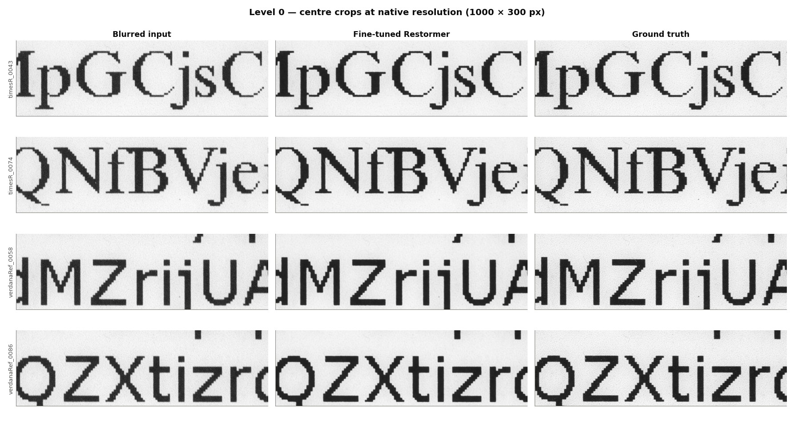

**Per-image metrics and OCR output for the four images shown**

| Image | Method | PSNR (dB) | SSIM | Char acc % | Token acc % | CER % | Ground-truth text | EasyOCR output |
|:--|:--|--:|--:|--:|--:|--:|:--|:--|
| timesR_0043 | Blurred input | 27.31 | 0.5723 | — | — | — | `UvYHwVV w qMpGCjsCET aYBEqDMKia` | `not run` |
| timesR_0043 | Pretrained Restormer | 25.66 | 0.5624 | — | — | — | `UvYHwVV w qMpGCjsCET aYBEqDMKia` | `not run` |
| timesR_0043 | Fine-tuned Restormer | 30.80 | 0.7196 | — | — | — | `UvYHwVV w qMpGCjsCET aYBEqDMKia` | `not run` |
| timesR_0074 | Blurred input | 27.63 | 0.5907 | — | — | — | `gjjKRzJCGf tQNfBVjeir gZkHVeQL A` | `not run` |
| timesR_0074 | Pretrained Restormer | 26.07 | 0.5911 | — | — | — | `gjjKRzJCGf tQNfBVjeir gZkHVeQL A` | `not run` |
| timesR_0074 | Fine-tuned Restormer | 31.51 | 0.7370 | — | — | — | `gjjKRzJCGf tQNfBVjeir gZkHVeQL A` | `not run` |
| verdanaRef_0058 | Blurred input | 24.14 | 0.4356 | — | — | — | `SVLxcnyqXz rdMZrijUAk pcZcVRx mR` | `not run` |
| verdanaRef_0058 | Pretrained Restormer | 23.76 | 0.4616 | — | — | — | `SVLxcnyqXz rdMZrijUAk pcZcVRx mR` | `not run` |
| verdanaRef_0058 | Fine-tuned Restormer | 25.68 | 0.6359 | — | — | — | `SVLxcnyqXz rdMZrijUAk pcZcVRx mR` | `not run` |
| verdanaRef_0086 | Blurred input | 23.60 | 0.4151 | — | — | — | `QpV DupqJM RQZXtizrdL rBddmaBHZK` | `not run` |
| verdanaRef_0086 | Pretrained Restormer | 23.21 | 0.4399 | — | — | — | `QpV DupqJM RQZXtizrdL rBddmaBHZK` | `not run` |
| verdanaRef_0086 | Fine-tuned Restormer | 24.94 | 0.6188 | — | — | — | `QpV DupqJM RQZXtizrdL rBddmaBHZK` | `not run` |


**Observations**

- **What this level is.** Step 0 is the mildest setting in the dataset: the "blurred" camera is only slightly out of focus, so the input already scores 26.08 dB / 0.524 SSIM against the ground truth.
- **Restoration quality.** Fine-tuning still helps: 28.74 dB / 0.691 SSIM (+2.66 dB, +0.167 SSIM), and every one of the 40 test images improves on both metrics. The un-tuned pretrained model *lowers* PSNR (24.98 dB), which is the same domain-mismatch pattern seen at every level.
- **Font gap.** Times outputs reach 30.41 dB while Verdana reaches 27.06 dB. The same gap is present in the blurred inputs (27.11 vs 25.05 dB), so it comes from the data (the Verdana pairs at this step differ more from their ground truth), not from the model.
- **Gap in the exported results.** The Level 0 folder has a best/last checkpoint, training log, split, registration files and all 80 restored PNGs, but **no `level0_summary.csv`, `level0_per_image.csv`, `ocr_outputs.csv` or `manifest.json`**. The OCR/summary cells were therefore not run (or not saved) for this level. The PSNR/SSIM values here were recomputed for this report from the saved restored images and the dataset, using the notebook's exact preprocessing; the same recomputation reproduces the notebook's own CSV values for Levels 1–9 to within 0.003 dB. **OCR accuracy for Level 0 is not available.**

---

### 8.2 Level 1

| Item | Value |
|:--|:--|
| Dataset archive | `HDC2021_step1.zip` — 200 pairs (100 Times, 100 Verdana) |
| Split (same image IDs at every level) | 150 train / 10 validation / 40 test |
| Estimated blur σ | 5 px (grid minimum — treat as "≤ 5 px") |
| Registration alignment score (NCC) | 0.950 before → 0.970 after (worst pair 0.966) |
| Global affine (input → GT) | scale x 1.0003, scale y 0.9951, shift (-0.8, 10.3) px |
| Initial weights | Original pretrained Restormer (`single_image_defocus_deblurring.pth`); no curriculum from other levels |
| Training patch × batch | 128 px × 4 |
| Iterations / learning rate | 3000 / 2e-5 (cosine decay to 1e-7) |
| Inference tiling | 768 px tiles, 192 px overlap |
| Best checkpoint | iteration 2500 — validation 28.83 dB / SSIM 0.6277 |
| Run date / wall time | 2026-11-12 / 45 min on a Tesla T4 |
| Checkpoints | `level_01/checkpoints/level1_best.pth` (104.7 MB, weights only), `level1_last.pth` (283.7 MB, with optimiser state) |


**Validation during training** (10 held-out images, full-image tiled inference)

| Iteration | 0 | 500 | 1000 | 1500 | 2000 | 2500 | 3000 |
|:--|--:|--:|--:|--:|--:|--:|--:|
| PSNR (dB) | 22.46 | 27.90 | 28.43 | 28.38 | 28.65 | 28.83 | 28.83 |
| SSIM | 0.4579 | 0.6220 | 0.6253 | 0.6253 | 0.6271 | 0.6277 | 0.6277 |


**Test-set results** (n = 40; mean ± standard deviation across images)

| Method | PSNR (dB) | SSIM | Char acc % | Char acc range % | Token acc % | CER % | WER % | Mean edit distance | Exact-match % | Empty OCR % |
|:--|--:|--:|--:|--:|--:|--:|--:|--:|--:|--:|
| Blurred input | 23.17 ± 0.24 | 0.4193 ± 0.0085 | 98.35 ± 2.01 | 93.5 – 100.0 | 85.79 | 1.65 | 15.88 | 0.53 | 55.0 | 0 |
| Pretrained Restormer | 22.47 ± 0.28 | 0.4552 ± 0.0082 | 98.11 ± 2.11 | 93.5 – 100.0 | 83.71 | 1.89 | 19.62 | 0.60 | 50.0 | 0 |
| Fine-tuned Restormer | 28.87 ± 0.87 | 0.6265 ± 0.0080 | 92.62 ± 6.73 | 71.9 – 100.0 | 60.50 | 7.38 | 56.88 | 2.35 | 20.0 | 0 |
| Sharp GT (upper bound) | — | — | 90.81 ± 7.01 | 75.0 – 100.0 | 57.42 | 9.19 | 64.96 | 2.92 | 15.0 | 0 |


Fine-tuned vs blurred input: **+5.70 dB PSNR, +0.2072 SSIM, -5.7 points character accuracy, -25.3 points token accuracy.** Fine-tuned vs pretrained: +6.40 dB, +0.1713 SSIM, -5.5 points character accuracy. Per image: PSNR improved on 40/40, SSIM on 40/40; character accuracy better / equal / worse than blurred on 1 / 11 / 28 images.

**By font**

| L | Method | Font | PSNR (dB) | SSIM | Char acc % | Token acc % | CER % | WER % |
|--:|:--|:--|--:|--:|--:|--:|--:|--:|
| 1 | Blurred input | timesR | 23.12 | 0.4251 | 98.44 | 86.17 | 1.56 | 17.17 |
| 1 | Blurred input | verdanaRef | 23.22 | 0.4136 | 98.27 | 85.42 | 1.73 | 14.58 |
| 1 | Pretrained Restormer | timesR | 22.39 | 0.4600 | 97.96 | 82.00 | 2.04 | 24.67 |
| 1 | Pretrained Restormer | verdanaRef | 22.54 | 0.4504 | 98.27 | 85.42 | 1.73 | 14.58 |
| 1 | Fine-tuned Restormer | timesR | 29.54 | 0.6327 | 89.49 | 51.75 | 10.51 | 77.83 |
| 1 | Fine-tuned Restormer | verdanaRef | 28.20 | 0.6202 | 95.75 | 69.25 | 4.25 | 35.92 |
| 1 | Sharp GT (upper bound) | timesR | — | — | 87.27 | 45.58 | 12.73 | 88.58 |
| 1 | Sharp GT (upper bound) | verdanaRef | — | — | 94.35 | 69.25 | 5.65 | 41.33 |


**Image comparison — blurred (left), fine-tuned (middle), ground truth (right)**

The four images are test-split positions 1, 11, 21 and 31 (two Times, two Verdana), chosen by position rather than by result. The same four image IDs are shown at every level.

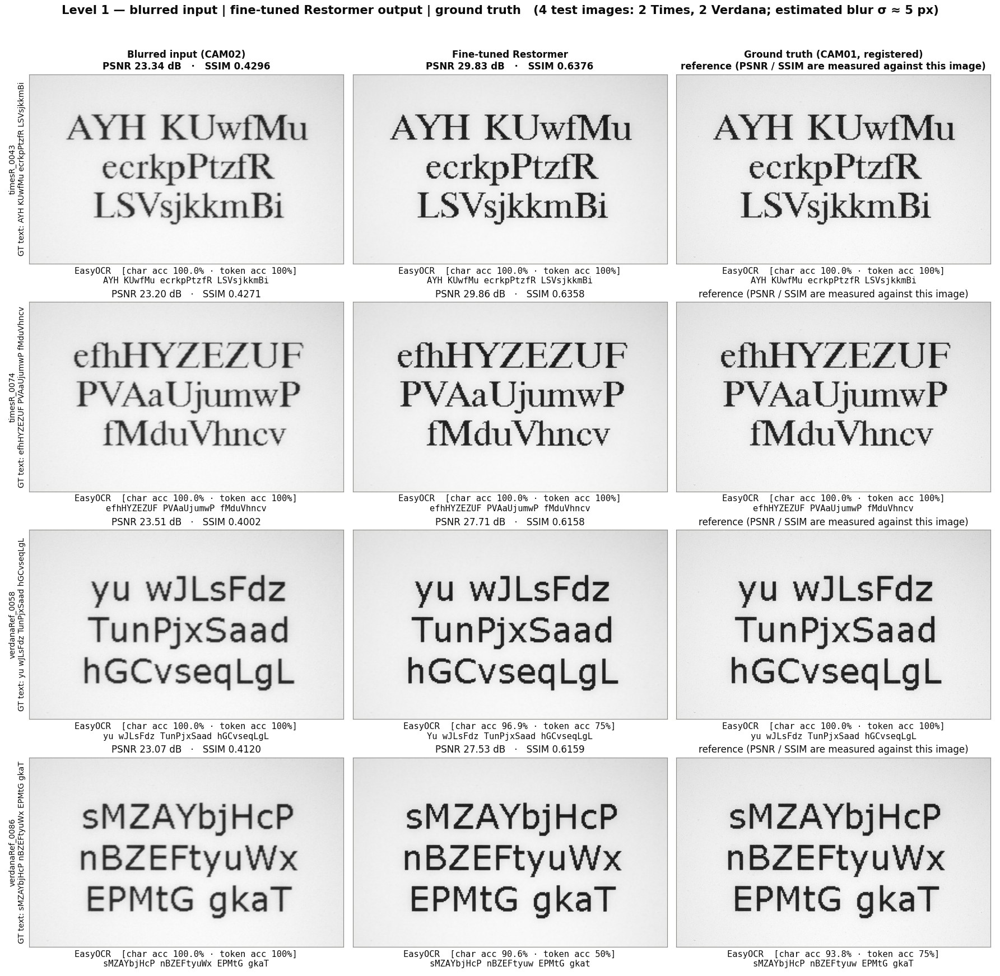

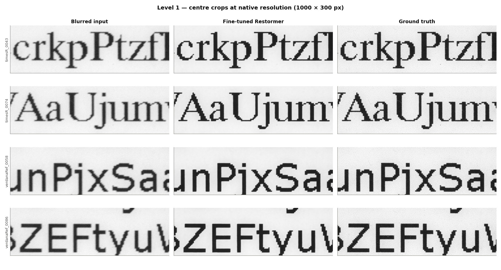

**Per-image metrics and OCR output for the four images shown**

| Image | Method | PSNR (dB) | SSIM | Char acc % | Token acc % | CER % | Ground-truth text | EasyOCR output |
|:--|:--|--:|--:|--:|--:|--:|:--|:--|
| timesR_0043 | Blurred input | 23.34 | 0.4296 | 100.0 | 100 | 0.0 | `AYH KUwfMu ecrkpPtzfR LSVsjkkmBi` | `AYH KUwfMu ecrkpPtzfR LSVsjkkmBi` |
| timesR_0043 | Pretrained Restormer | 22.61 | 0.4671 | 100.0 | 100 | 0.0 | `AYH KUwfMu ecrkpPtzfR LSVsjkkmBi` | `AYH KUwfMu ecrkpPtzfR LSVsjkkmBi` |
| timesR_0043 | Fine-tuned Restormer | 29.83 | 0.6376 | 100.0 | 100 | 0.0 | `AYH KUwfMu ecrkpPtzfR LSVsjkkmBi` | `AYH KUwfMu ecrkpPtzfR LSVsjkkmBi` |
| timesR_0043 | Sharp GT (upper bound) | — | — | 100.0 | 100 | 0.0 | `AYH KUwfMu ecrkpPtzfR LSVsjkkmBi` | `AYH KUwfMu ecrkpPtzfR LSVsjkkmBi` |
| timesR_0074 | Blurred input | 23.20 | 0.4271 | 100.0 | 100 | 0.0 | `efhHYZEZUF PVAaUjumwP fMduVhncv` | `efhHYZEZUF PVAaUjumwP fMduVhncv` |
| timesR_0074 | Pretrained Restormer | 22.50 | 0.4631 | 100.0 | 100 | 0.0 | `efhHYZEZUF PVAaUjumwP fMduVhncv` | `efhHYZEZUF PVAaUjumwP fMduVhncv` |
| timesR_0074 | Fine-tuned Restormer | 29.86 | 0.6358 | 100.0 | 100 | 0.0 | `efhHYZEZUF PVAaUjumwP fMduVhncv` | `efhHYZEZUF PVAaUjumwP fMduVhncv` |
| timesR_0074 | Sharp GT (upper bound) | — | — | 100.0 | 100 | 0.0 | `efhHYZEZUF PVAaUjumwP fMduVhncv` | `efhHYZEZUF PVAaUjumwP fMduVhncv` |
| verdanaRef_0058 | Blurred input | 23.51 | 0.4002 | 100.0 | 100 | 0.0 | `yu wJLsFdz TunPjxSaad hGCvseqLgL` | `yu wJLsFdz TunPjxSaad hGCvseqLgL` |
| verdanaRef_0058 | Pretrained Restormer | 23.07 | 0.4381 | 100.0 | 100 | 0.0 | `yu wJLsFdz TunPjxSaad hGCvseqLgL` | `yu wJLsFdz TunPjxSaad hGCvseqLgL` |
| verdanaRef_0058 | Fine-tuned Restormer | 27.71 | 0.6158 | 96.9 | 75 | 3.1 | `yu wJLsFdz TunPjxSaad hGCvseqLgL` | `Yu wJLsFdz TunPjxSaad hGCvseqLgL` |
| verdanaRef_0058 | Sharp GT (upper bound) | — | — | 100.0 | 100 | 0.0 | `yu wJLsFdz TunPjxSaad hGCvseqLgL` | `yu wJLsFdz TunPjxSaad hGCvseqLgL` |
| verdanaRef_0086 | Blurred input | 23.07 | 0.4120 | 100.0 | 100 | 0.0 | `sMZAYbjHcP nBZEFtyuWx EPMtG gkaT` | `sMZAYbjHcP nBZEFtyuWx EPMtG gkaT` |
| verdanaRef_0086 | Pretrained Restormer | 22.41 | 0.4480 | 100.0 | 100 | 0.0 | `sMZAYbjHcP nBZEFtyuWx EPMtG gkaT` | `sMZAYbjHcP nBZEFtyuWx EPMtG gkaT` |
| verdanaRef_0086 | Fine-tuned Restormer | 27.53 | 0.6159 | 90.6 | 50 | 9.4 | `sMZAYbjHcP nBZEFtyuWx EPMtG gkaT` | `sMZAYbjHcP nBZEFtyuw EPMtG gkat` |
| verdanaRef_0086 | Sharp GT (upper bound) | — | — | 93.8 | 75 | 6.2 | `sMZAYbjHcP nBZEFtyuWx EPMtG gkaT` | `sMZAYbjHcP nBZEFtyuw EPMtG gkaT` |


**Observations**

- **Image quality improves strongly.** +5.70 dB PSNR and +0.207 SSIM over the blurred input; all 40 test images improve.
- **OCR accuracy goes down, not up.** EasyOCR already reads the Level 1 blurred input at 98.35% character accuracy. After restoration it reads 92.62% (−5.7 points); 28 of 40 images get worse, 11 tie and 1 improves.
- **Why.** The sharp ground truth itself only scores 90.81%. On the sharp, high-contrast renderings EasyOCR repeatedly drops wide glyphs (for example `pApReWCcGs` is read as `pApRe CcGs` on both the ground truth and the fine-tuned output, but correctly on the blurred input). The fine-tuned model makes the image look like the ground truth, so it inherits the recogniser's behaviour on ground-truth-like images. At this level the blur is too mild to hurt recognition, so deblurring has nothing to gain on the OCR metric.
- **Practical reading.** For Level 1 (and by extension Level 0) the restoration is a visual-quality improvement only; a recognition-driven pipeline should pass these images through unchanged.

---

### 8.3 Level 2

| Item | Value |
|:--|:--|
| Dataset archive | `HDC2021_step2.zip` — 200 pairs (100 Times, 100 Verdana) |
| Split (same image IDs at every level) | 150 train / 10 validation / 40 test |
| Estimated blur σ | 5 px (grid minimum — treat as "≤ 5 px") |
| Registration alignment score (NCC) | 0.906 before → 0.960 after (worst pair 0.953) |
| Global affine (input → GT) | scale x 1.0072, scale y 1.0029, shift (-7.8, 6.4) px |
| Initial weights | Original pretrained Restormer (`single_image_defocus_deblurring.pth`); no curriculum from other levels |
| Training patch × batch | 128 px × 4 |
| Iterations / learning rate | 3000 / 2e-5 (cosine decay to 1e-7) |
| Inference tiling | 768 px tiles, 192 px overlap |
| Best checkpoint | iteration 3000 — validation 27.47 dB / SSIM 0.6129 |
| Run date / wall time | 2026-11-12 / 44 min on a Tesla T4 |
| Checkpoints | `level_02/checkpoints/level2_best.pth` (104.7 MB, weights only), `level2_last.pth` (283.7 MB, with optimiser state) |


**Validation during training** (10 held-out images, full-image tiled inference)

| Iteration | 0 | 500 | 1000 | 1500 | 2000 | 2500 | 3000 |
|:--|--:|--:|--:|--:|--:|--:|--:|
| PSNR (dB) | 18.93 | 26.55 | 27.18 | 27.37 | 27.43 | 27.44 | 27.47 |
| SSIM | 0.4393 | 0.6064 | 0.6112 | 0.6121 | 0.6126 | 0.6128 | 0.6129 |


**Test-set results** (n = 40; mean ± standard deviation across images)

| Method | PSNR (dB) | SSIM | Char acc % | Char acc range % | Token acc % | CER % | WER % | Mean edit distance | Exact-match % | Empty OCR % |
|:--|--:|--:|--:|--:|--:|--:|--:|--:|--:|--:|
| Blurred input | 19.37 ± 0.26 | 0.3902 ± 0.0072 | 94.25 ± 5.72 | 75.0 – 100.0 | 63.54 | 5.75 | 42.71 | 1.82 | 22.5 | 0 |
| Pretrained Restormer | 18.84 ± 0.25 | 0.4403 ± 0.0078 | 94.97 ± 5.15 | 81.2 – 100.0 | 65.00 | 5.03 | 39.79 | 1.60 | 25.0 | 0 |
| Fine-tuned Restormer | 27.38 ± 0.64 | 0.6151 ± 0.0083 | 96.07 ± 5.27 | 75.0 – 100.0 | 75.00 | 3.93 | 27.50 | 1.25 | 37.5 | 0 |
| Sharp GT (upper bound) | — | — | 92.16 ± 6.76 | 71.9 – 100.0 | 55.62 | 7.84 | 58.54 | 2.50 | 20.0 | 0 |


Fine-tuned vs blurred input: **+8.01 dB PSNR, +0.2249 SSIM, +1.8 points character accuracy, +11.5 points token accuracy.** Fine-tuned vs pretrained: +8.54 dB, +0.1748 SSIM, +1.1 points character accuracy. Per image: PSNR improved on 40/40, SSIM on 40/40; character accuracy better / equal / worse than blurred on 18 / 17 / 5 images.

**By font**

| L | Method | Font | PSNR (dB) | SSIM | Char acc % | Token acc % | CER % | WER % |
|--:|:--|:--|--:|--:|--:|--:|--:|--:|
| 2 | Blurred input | timesR | 19.21 | 0.3943 | 90.53 | 45.83 | 9.47 | 66.67 |
| 2 | Blurred input | verdanaRef | 19.52 | 0.3861 | 97.97 | 81.25 | 2.03 | 18.75 |
| 2 | Pretrained Restormer | timesR | 18.73 | 0.4450 | 91.81 | 47.50 | 8.19 | 62.08 |
| 2 | Pretrained Restormer | verdanaRef | 18.96 | 0.4356 | 98.12 | 82.50 | 1.88 | 17.50 |
| 2 | Fine-tuned Restormer | timesR | 27.90 | 0.6214 | 93.85 | 65.83 | 6.15 | 39.17 |
| 2 | Fine-tuned Restormer | verdanaRef | 26.86 | 0.6089 | 98.28 | 84.17 | 1.72 | 15.83 |
| 2 | Sharp GT (upper bound) | timesR | — | — | 88.69 | 42.50 | 11.31 | 84.17 |
| 2 | Sharp GT (upper bound) | verdanaRef | — | — | 95.62 | 68.75 | 4.38 | 32.92 |


**Image comparison — blurred (left), fine-tuned (middle), ground truth (right)**

The four images are test-split positions 1, 11, 21 and 31 (two Times, two Verdana), chosen by position rather than by result. The same four image IDs are shown at every level.

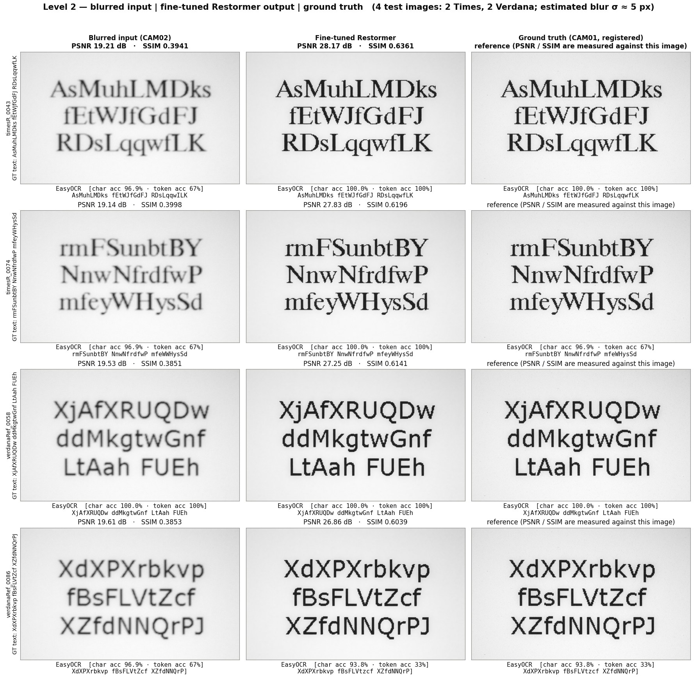

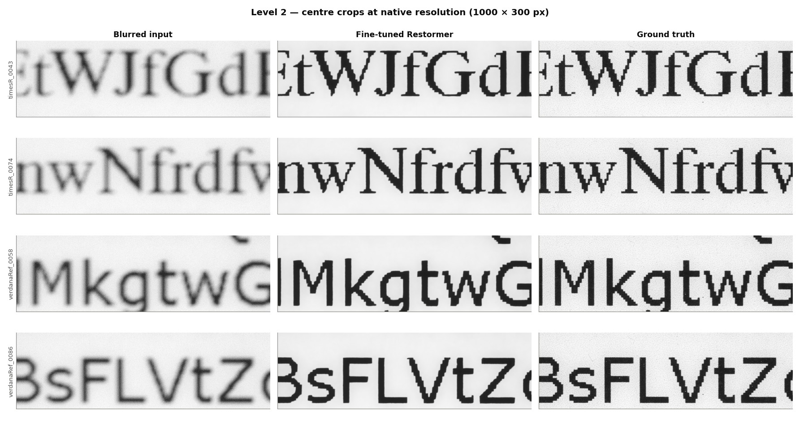

**Per-image metrics and OCR output for the four images shown**

| Image | Method | PSNR (dB) | SSIM | Char acc % | Token acc % | CER % | Ground-truth text | EasyOCR output |
|:--|:--|--:|--:|--:|--:|--:|:--|:--|
| timesR_0043 | Blurred input | 19.21 | 0.3941 | 96.9 | 67 | 3.1 | `AsMuhLMDks fEtWJfGdFJ RDsLqqwfLK` | `AsMuhLMDks fEtWJfGdFJ RDsLqqwILK` |
| timesR_0043 | Pretrained Restormer | 18.75 | 0.4471 | 93.8 | 67 | 6.2 | `AsMuhLMDks fEtWJfGdFJ RDsLqqwfLK` | `AsMuhLMDks [EtWJGdFJ RDsLqqwfLK` |
| timesR_0043 | Fine-tuned Restormer | 28.17 | 0.6361 | 100.0 | 100 | 0.0 | `AsMuhLMDks fEtWJfGdFJ RDsLqqwfLK` | `AsMuhLMDks fEtWJfGdFJ RDsLqqwfLK` |
| timesR_0043 | Sharp GT (upper bound) | — | — | 100.0 | 100 | 0.0 | `AsMuhLMDks fEtWJfGdFJ RDsLqqwfLK` | `AsMuhLMDks fEtWJfGdFJ RDsLqqwfLK` |
| timesR_0074 | Blurred input | 19.14 | 0.3998 | 96.9 | 67 | 3.1 | `rmFSunbtBY NnwNfrdfwP mfeyWHysSd` | `rmFSunbtBY NnwNfrdfwP mfeWWHysSd` |
| timesR_0074 | Pretrained Restormer | 18.62 | 0.4496 | 96.9 | 67 | 3.1 | `rmFSunbtBY NnwNfrdfwP mfeyWHysSd` | `rmFSunbtBY NnwNfrdfwP mfewWHysSd` |
| timesR_0074 | Fine-tuned Restormer | 27.83 | 0.6196 | 100.0 | 100 | 0.0 | `rmFSunbtBY NnwNfrdfwP mfeyWHysSd` | `rmFSunbtBY NnwNfrdfwP mfeyWHysSd` |
| timesR_0074 | Sharp GT (upper bound) | — | — | 96.9 | 67 | 3.1 | `rmFSunbtBY NnwNfrdfwP mfeyWHysSd` | `rmFSunbtBY NnwNfrdfwP mfeWHysSd` |
| verdanaRef_0058 | Blurred input | 19.53 | 0.3851 | 100.0 | 100 | 0.0 | `XjAfXRUQDw ddMkgtwGnf LtAah FUEh` | `XjAfXRUQDw ddMkgtwGnf LtAah FUEh` |
| verdanaRef_0058 | Pretrained Restormer | 18.96 | 0.4351 | 100.0 | 100 | 0.0 | `XjAfXRUQDw ddMkgtwGnf LtAah FUEh` | `XjAfXRUQDw ddMkgtwGnf LtAah FUEh` |
| verdanaRef_0058 | Fine-tuned Restormer | 27.25 | 0.6141 | 100.0 | 100 | 0.0 | `XjAfXRUQDw ddMkgtwGnf LtAah FUEh` | `XjAfXRUQDw ddMkgtwGnf LtAah FUEh` |
| verdanaRef_0058 | Sharp GT (upper bound) | — | — | 100.0 | 100 | 0.0 | `XjAfXRUQDw ddMkgtwGnf LtAah FUEh` | `XjAfXRUQDw ddMkgtwGnf LtAah FUEh` |
| verdanaRef_0086 | Blurred input | 19.61 | 0.3853 | 96.9 | 67 | 3.1 | `XdXPXrbkvp fBsFLVtZcf XZfdNNQrPJ` | `XdXPXrbkvp fBsFLVtZcf XZfdNNQrP]` |
| verdanaRef_0086 | Pretrained Restormer | 19.03 | 0.4344 | 96.9 | 67 | 3.1 | `XdXPXrbkvp fBsFLVtZcf XZfdNNQrPJ` | `XdXPXrbkvp fBsFLVtZcf XZfdNNQrP]` |
| verdanaRef_0086 | Fine-tuned Restormer | 26.86 | 0.6039 | 93.8 | 33 | 6.2 | `XdXPXrbkvp fBsFLVtZcf XZfdNNQrPJ` | `XdXPXrbkvp fBsFLVtzcf XZfdNNQrP]` |
| verdanaRef_0086 | Sharp GT (upper bound) | — | — | 93.8 | 33 | 6.2 | `XdXPXrbkvp fBsFLVtZcf XZfdNNQrPJ` | `XdXPXrbkvp fBsFLVtzcf XZfdNNQrP]` |


**Observations**

- **First level where restoration helps OCR.** Character accuracy rises from 94.25% to 96.07% and token accuracy from 63.5% to 75.0%; 18 images improve, 17 tie, 5 get worse.
- **PSNR gain jumps to +8.01 dB** (19.37 → 27.38 dB), SSIM +0.225.
- **Blur estimate caveat.** The estimated σ is 5 px for Levels 0, 1 and 2 alike. 5 px is the smallest value in the search grid, so for these three levels the estimate is a floor, not a measurement; the PSF images in §3 show the blur does grow from step 0 to step 2.

---

### 8.4 Level 3

| Item | Value |
|:--|:--|
| Dataset archive | `HDC2021_step3.zip` — 200 pairs (100 Times, 100 Verdana) |
| Split (same image IDs at every level) | 150 train / 10 validation / 40 test |
| Estimated blur σ | 12 px |
| Registration alignment score (NCC) | 0.864 before → 0.948 after (worst pair 0.941) |
| Global affine (input → GT) | scale x 1.0143, scale y 1.0097, shift (-14.8, 3.8) px |
| Initial weights | Original pretrained Restormer (`single_image_defocus_deblurring.pth`); no curriculum from other levels |
| Training patch × batch | 128 px × 4 |
| Iterations / learning rate | 3000 / 2e-5 (cosine decay to 1e-7) |
| Inference tiling | 768 px tiles, 192 px overlap |
| Best checkpoint | iteration 2000 — validation 25.76 dB / SSIM 0.6052 |
| Run date / wall time | 2026-11-12 / 48 min on a Tesla T4 |
| Checkpoints | `level_03/checkpoints/level3_best.pth` (104.7 MB, weights only), `level3_last.pth` (283.7 MB, with optimiser state) |


**Validation during training** (10 held-out images, full-image tiled inference)

| Iteration | 0 | 500 | 1000 | 1500 | 2000 | 2500 | 3000 |
|:--|--:|--:|--:|--:|--:|--:|--:|
| PSNR (dB) | 17.03 | 24.70 | 25.37 | 25.40 | 25.76 | 25.72 | 25.74 |
| SSIM | 0.4375 | 0.5977 | 0.6025 | 0.6033 | 0.6052 | 0.6050 | 0.6051 |


**Test-set results** (n = 40; mean ± standard deviation across images)

| Method | PSNR (dB) | SSIM | Char acc % | Char acc range % | Token acc % | CER % | WER % | Mean edit distance | Exact-match % | Empty OCR % |
|:--|--:|--:|--:|--:|--:|--:|--:|--:|--:|--:|
| Blurred input | 17.34 ± 0.22 | 0.3795 ± 0.0072 | 75.55 ± 17.80 | 40.6 – 100.0 | 24.04 | 24.45 | 88.04 | 7.80 | 2.5 | 0 |
| Pretrained Restormer | 16.95 ± 0.24 | 0.4353 ± 0.0068 | 75.54 ± 17.51 | 37.5 – 100.0 | 23.50 | 24.46 | 93.29 | 7.80 | 2.5 | 0 |
| Fine-tuned Restormer | 25.72 ± 0.28 | 0.6056 ± 0.0051 | 98.28 ± 2.46 | 93.5 – 100.0 | 86.46 | 1.72 | 14.17 | 0.55 | 62.5 | 0 |
| Sharp GT (upper bound) | — | — | 92.48 ± 6.14 | 68.8 – 100.0 | 63.79 | 7.52 | 49.92 | 2.40 | 20.0 | 0 |


Fine-tuned vs blurred input: **+8.38 dB PSNR, +0.2261 SSIM, +22.7 points character accuracy, +62.4 points token accuracy.** Fine-tuned vs pretrained: +8.77 dB, +0.1703 SSIM, +22.7 points character accuracy. Per image: PSNR improved on 40/40, SSIM on 40/40; character accuracy better / equal / worse than blurred on 38 / 2 / 0 images.

**By font**

| L | Method | Font | PSNR (dB) | SSIM | Char acc % | Token acc % | CER % | WER % |
|--:|:--|:--|--:|--:|--:|--:|--:|--:|
| 3 | Blurred input | timesR | 17.39 | 0.3831 | 60.18 | 3.00 | 39.82 | 119.50 |
| 3 | Blurred input | verdanaRef | 17.28 | 0.3759 | 90.92 | 45.08 | 9.08 | 56.58 |
| 3 | Pretrained Restormer | timesR | 17.05 | 0.4382 | 60.64 | 6.50 | 39.36 | 125.42 |
| 3 | Pretrained Restormer | verdanaRef | 16.86 | 0.4324 | 90.44 | 40.50 | 9.56 | 61.17 |
| 3 | Fine-tuned Restormer | timesR | 25.71 | 0.6092 | 99.06 | 92.75 | 0.94 | 8.50 |
| 3 | Fine-tuned Restormer | verdanaRef | 25.73 | 0.6020 | 97.49 | 80.17 | 2.51 | 19.83 |
| 3 | Sharp GT (upper bound) | timesR | — | — | 89.80 | 55.58 | 10.20 | 67.92 |
| 3 | Sharp GT (upper bound) | verdanaRef | — | — | 95.15 | 72.00 | 4.85 | 31.92 |


**Image comparison — blurred (left), fine-tuned (middle), ground truth (right)**

The four images are test-split positions 1, 11, 21 and 31 (two Times, two Verdana), chosen by position rather than by result. The same four image IDs are shown at every level.

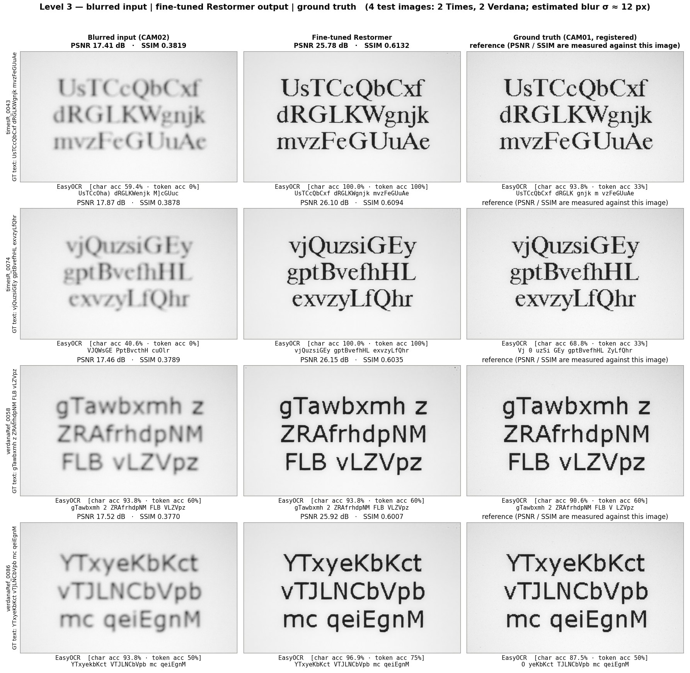

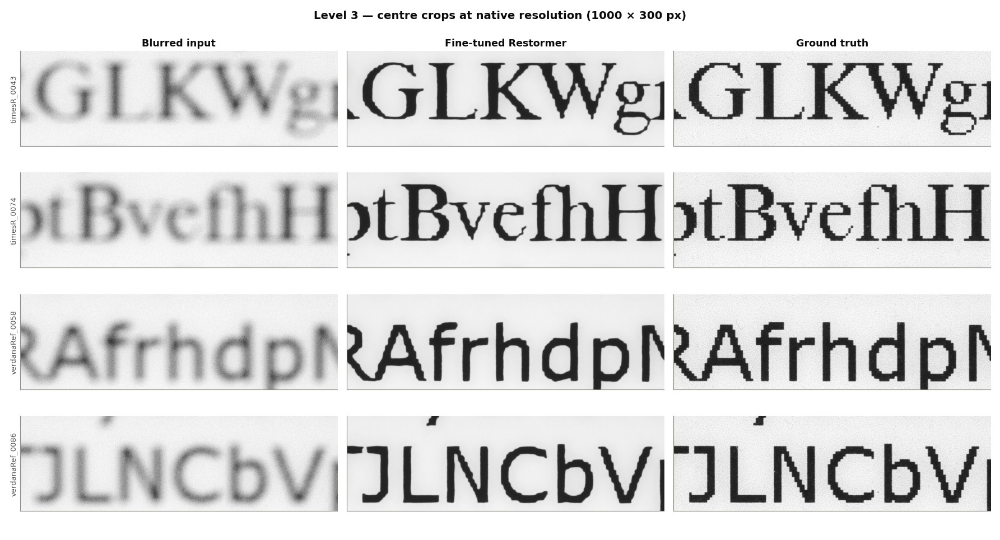

**Per-image metrics and OCR output for the four images shown**

| Image | Method | PSNR (dB) | SSIM | Char acc % | Token acc % | CER % | Ground-truth text | EasyOCR output |
|:--|:--|--:|--:|--:|--:|--:|:--|:--|
| timesR_0043 | Blurred input | 17.41 | 0.3819 | 59.4 | 0 | 40.6 | `UsTCcQbCxf dRGLKWgnjk mvzFeGUuAe` | `UsTCcOha) dRGLKWenjk M]cGUuc` |
| timesR_0043 | Pretrained Restormer | 17.09 | 0.4376 | 59.4 | 0 | 40.6 | `UsTCcQbCxf dRGLKWgnjk mvzFeGUuAe` | `UsT CcObe dRGLKWenjk M[cGUuc` |
| timesR_0043 | Fine-tuned Restormer | 25.78 | 0.6132 | 100.0 | 100 | 0.0 | `UsTCcQbCxf dRGLKWgnjk mvzFeGUuAe` | `UsTCcQbCxf dRGLKWgnjk mvzFeGUuAe` |
| timesR_0043 | Sharp GT (upper bound) | — | — | 93.8 | 33 | 6.2 | `UsTCcQbCxf dRGLKWgnjk mvzFeGUuAe` | `UsTCcQbCxf dRGLK gnjk m vzFeGUuAe` |
| timesR_0074 | Blurred input | 17.87 | 0.3878 | 40.6 | 0 | 59.4 | `vjQuzsiGEy gptBvefhHL exvzyLfQhr` | `VJQWsGE PptBvcthH cuOlr` |
| timesR_0074 | Pretrained Restormer | 17.56 | 0.4441 | 37.5 | 0 | 62.5 | `vjQuzsiGEy gptBvefhHL exvzyLfQhr` | `VQwsiGlV Ppt BvcthH[ c Olr` |
| timesR_0074 | Fine-tuned Restormer | 26.10 | 0.6094 | 100.0 | 100 | 0.0 | `vjQuzsiGEy gptBvefhHL exvzyLfQhr` | `vjQuzsiGEy gptBvefhHL exvzyLfQhr` |
| timesR_0074 | Sharp GT (upper bound) | — | — | 68.8 | 33 | 31.2 | `vjQuzsiGEy gptBvefhHL exvzyLfQhr` | `Vj 0 uzSi GEy gptBvefhHL ZyLfQhr` |
| verdanaRef_0058 | Blurred input | 17.46 | 0.3789 | 93.8 | 60 | 6.2 | `gTawbxmh z ZRAfrhdpNM FLB vLZVpz` | `gTawbxmh 2 ZRAfrhdpNM FLB VLZVpz` |
| verdanaRef_0058 | Pretrained Restormer | 17.03 | 0.4364 | 90.6 | 40 | 9.4 | `gTawbxmh z ZRAfrhdpNM FLB vLZVpz` | `gTawbxmh 2 ZRAfrhapNM FLB VLZVpz` |
| verdanaRef_0058 | Fine-tuned Restormer | 26.15 | 0.6035 | 93.8 | 60 | 6.2 | `gTawbxmh z ZRAfrhdpNM FLB vLZVpz` | `gTawbxmh 2 ZRAfrhdpNM FLB VLZVpz` |
| verdanaRef_0058 | Sharp GT (upper bound) | — | — | 90.6 | 60 | 9.4 | `gTawbxmh z ZRAfrhdpNM FLB vLZVpz` | `gTawbxmh 2 ZRAfrhdpNM FLB V LZVpz` |
| verdanaRef_0086 | Blurred input | 17.52 | 0.3770 | 93.8 | 50 | 6.2 | `YTxyeKbKct vTJLNCbVpb mc qeiEgnM` | `YTxyekbKct VTJLNCbVpb mc qeiEgnM` |
| verdanaRef_0086 | Pretrained Restormer | 17.12 | 0.4340 | 96.9 | 75 | 3.1 | `YTxyeKbKct vTJLNCbVpb mc qeiEgnM` | `YTxyeKbKct VTJLNCbVpb mc qeiEgnM` |
| verdanaRef_0086 | Fine-tuned Restormer | 25.92 | 0.6007 | 96.9 | 75 | 3.1 | `YTxyeKbKct vTJLNCbVpb mc qeiEgnM` | `YTxyeKbKct VTJLNCbVpb mc qeiEgnM` |
| verdanaRef_0086 | Sharp GT (upper bound) | — | — | 87.5 | 50 | 12.5 | `YTxyeKbKct vTJLNCbVpb mc qeiEgnM` | `O yeKbKct TJLNCbVpb mc qeiEgnM` |


**Observations**

- **Best OCR result of the whole study.** Fine-tuned character accuracy is 98.28% and token accuracy 86.5%, with 62.5% of the test images transcribed with zero errors. The blurred input reads 75.55% / 24.0%.
- **Largest PSNR gain.** +8.38 dB (17.34 → 25.72 dB). 38 of 40 images improve on character accuracy, 2 tie, none get worse.
- **Above the "upper bound".** The fine-tuned output is read more accurately than the sharp ground truth (98.28% vs 92.48%). The slightly smoother, noise-free strokes produced by the network suit EasyOCR better than the grainy camera image (see §9.2).

---

### 8.5 Level 4

| Item | Value |
|:--|:--|
| Dataset archive | `HDC2021_step4.zip` — 200 pairs (100 Times, 100 Verdana) |
| Split (same image IDs at every level) | 150 train / 10 validation / 40 test |
| Estimated blur σ | 20 px |
| Registration alignment score (NCC) | 0.824 before → 0.915 after (worst pair 0.905) |
| Global affine (input → GT) | scale x 1.0217, scale y 1.0177, shift (-23.1, 0.8) px |
| Initial weights | Original pretrained Restormer (`single_image_defocus_deblurring.pth`); no curriculum from other levels |
| Training patch × batch | 128 px × 4 |
| Iterations / learning rate | 3000 / 2e-5 (cosine decay to 1e-7) |
| Inference tiling | 768 px tiles, 192 px overlap |
| Best checkpoint | iteration 3000 — validation 23.95 dB / SSIM 0.5939 |
| Run date / wall time | 2026-11-12 / 43 min on a Tesla T4 |
| Checkpoints | `level_04/checkpoints/level4_best.pth` (104.7 MB, weights only), `level4_last.pth` (283.7 MB, with optimiser state) |


**Validation during training** (10 held-out images, full-image tiled inference)

| Iteration | 0 | 500 | 1000 | 1500 | 2000 | 2500 | 3000 |
|:--|--:|--:|--:|--:|--:|--:|--:|
| PSNR (dB) | 15.85 | 23.55 | 23.65 | 23.52 | 23.82 | 23.91 | 23.95 |
| SSIM | 0.4249 | 0.5897 | 0.5916 | 0.5911 | 0.5933 | 0.5936 | 0.5939 |


**Test-set results** (n = 40; mean ± standard deviation across images)

| Method | PSNR (dB) | SSIM | Char acc % | Char acc range % | Token acc % | CER % | WER % | Mean edit distance | Exact-match % | Empty OCR % |
|:--|--:|--:|--:|--:|--:|--:|--:|--:|--:|--:|
| Blurred input | 16.07 ± 0.33 | 0.3730 ± 0.0086 | 23.48 ± 12.02 | 3.1 – 50.0 | 0.50 | 76.52 | 130.17 | 24.35 | 0.0 | 0 |
| Pretrained Restormer | 15.86 ± 0.35 | 0.4241 ± 0.0085 | 27.34 ± 11.76 | 9.4 – 53.1 | 0.50 | 72.66 | 134.96 | 23.12 | 0.0 | 0 |
| Fine-tuned Restormer | 24.10 ± 0.33 | 0.5949 ± 0.0041 | 97.40 ± 3.35 | 87.1 – 100.0 | 82.17 | 2.60 | 17.83 | 0.82 | 47.5 | 0 |
| Sharp GT (upper bound) | — | — | 91.27 ± 6.21 | 77.4 – 100.0 | 55.12 | 8.73 | 65.88 | 2.77 | 15.0 | 0 |


Fine-tuned vs blurred input: **+8.03 dB PSNR, +0.2220 SSIM, +73.9 points character accuracy, +81.7 points token accuracy.** Fine-tuned vs pretrained: +8.24 dB, +0.1709 SSIM, +70.1 points character accuracy. Per image: PSNR improved on 40/40, SSIM on 40/40; character accuracy better / equal / worse than blurred on 40 / 0 / 0 images.

**By font**

| L | Method | Font | PSNR (dB) | SSIM | Char acc % | Token acc % | CER % | WER % |
|--:|:--|:--|--:|--:|--:|--:|--:|--:|
| 4 | Blurred input | timesR | 16.30 | 0.3778 | 14.59 | 0.00 | 85.41 | 117.67 |
| 4 | Blurred input | verdanaRef | 15.83 | 0.3682 | 32.36 | 1.00 | 67.64 | 142.67 |
| 4 | Pretrained Restormer | timesR | 16.11 | 0.4286 | 18.07 | 0.00 | 81.93 | 125.08 |
| 4 | Pretrained Restormer | verdanaRef | 15.61 | 0.4196 | 36.60 | 1.00 | 63.40 | 144.83 |
| 4 | Fine-tuned Restormer | timesR | 23.92 | 0.5962 | 96.86 | 79.67 | 3.14 | 20.33 |
| 4 | Fine-tuned Restormer | verdanaRef | 24.28 | 0.5937 | 97.93 | 84.67 | 2.07 | 15.33 |
| 4 | Sharp GT (upper bound) | timesR | — | — | 88.54 | 44.42 | 11.46 | 86.75 |
| 4 | Sharp GT (upper bound) | verdanaRef | — | — | 93.99 | 65.83 | 6.01 | 45.00 |


**Image comparison — blurred (left), fine-tuned (middle), ground truth (right)**

The four images are test-split positions 1, 11, 21 and 31 (two Times, two Verdana), chosen by position rather than by result. The same four image IDs are shown at every level.

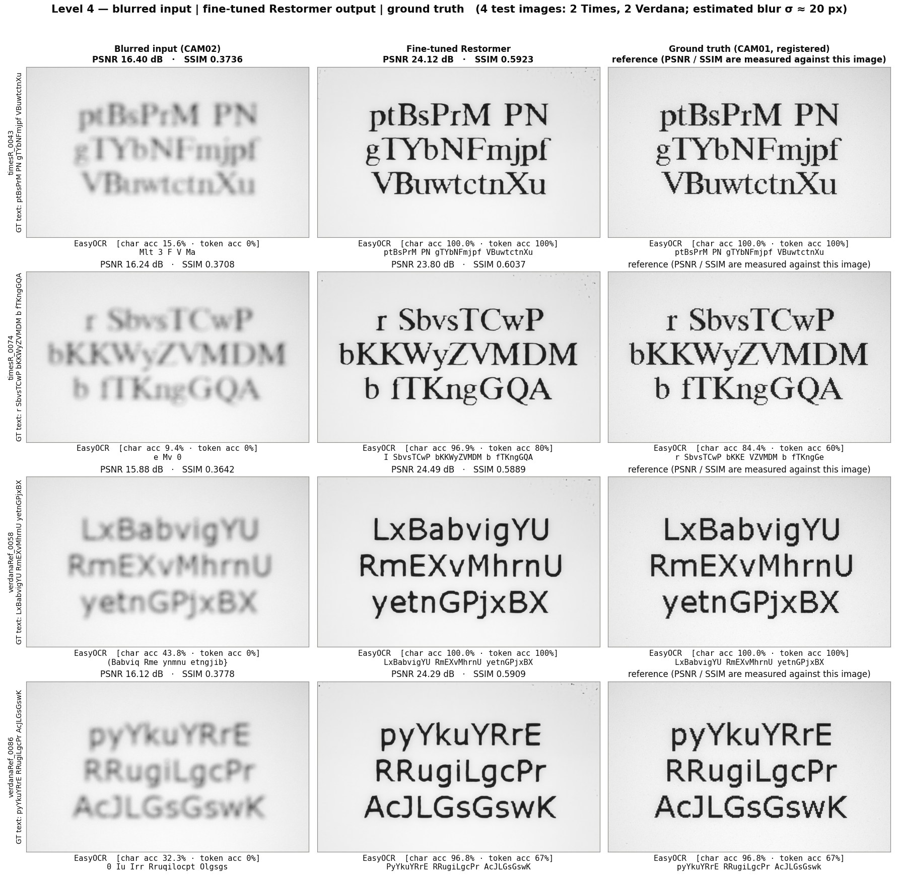

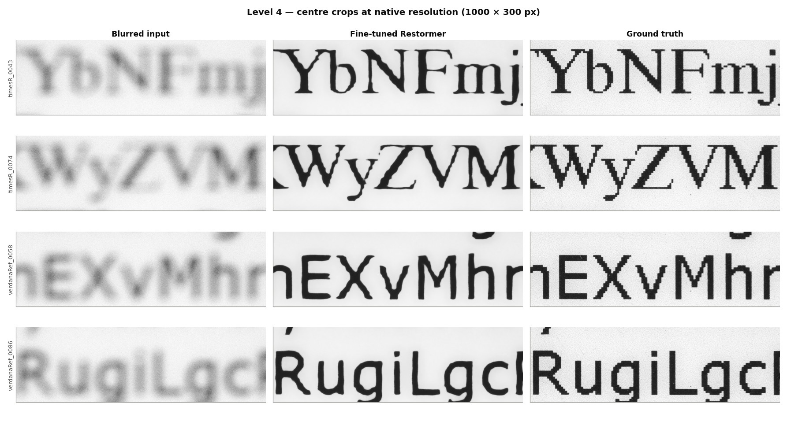

**Per-image metrics and OCR output for the four images shown**

| Image | Method | PSNR (dB) | SSIM | Char acc % | Token acc % | CER % | Ground-truth text | EasyOCR output |
|:--|:--|--:|--:|--:|--:|--:|:--|:--|
| timesR_0043 | Blurred input | 16.40 | 0.3736 | 15.6 | 0 | 84.4 | `ptBsPrM PN gTYbNFmjpf VBuwtctnXu` | `Mlt 3 F V Ma` |
| timesR_0043 | Pretrained Restormer | 16.19 | 0.4253 | 15.6 | 0 | 84.4 | `ptBsPrM PN gTYbNFmjpf VBuwtctnXu` | `mr~ IJpI Mrnc` |
| timesR_0043 | Fine-tuned Restormer | 24.12 | 0.5923 | 100.0 | 100 | 0.0 | `ptBsPrM PN gTYbNFmjpf VBuwtctnXu` | `ptBsPrM PN gTYbNFmjpf VBuwtctnXu` |
| timesR_0043 | Sharp GT (upper bound) | — | — | 100.0 | 100 | 0.0 | `ptBsPrM PN gTYbNFmjpf VBuwtctnXu` | `ptBsPrM PN gTYbNFmjpf VBuwtctnXu` |
| timesR_0074 | Blurred input | 16.24 | 0.3708 | 9.4 | 0 | 90.6 | `r SbvsTCwP bKKWyZVMDM b fTKngGQA` | `e Mv 0` |
| timesR_0074 | Pretrained Restormer | 16.03 | 0.4238 | 18.8 | 0 | 81.2 | `r SbvsTCwP bKKWyZVMDM b fTKngGQA` | `blh MDT R '0` |
| timesR_0074 | Fine-tuned Restormer | 23.80 | 0.6037 | 96.9 | 80 | 3.1 | `r SbvsTCwP bKKWyZVMDM b fTKngGQA` | `I SbvsTCwP bKKWyZVMDM b fTKngGQA` |
| timesR_0074 | Sharp GT (upper bound) | — | — | 84.4 | 60 | 15.6 | `r SbvsTCwP bKKWyZVMDM b fTKngGQA` | `r SbvsTCwP bKKE VZVMDM b fTKngGe` |
| verdanaRef_0058 | Blurred input | 15.88 | 0.3642 | 43.8 | 0 | 56.2 | `LxBabvigYU RmEXvMhrnU yetnGPjxBX` | `(Babviq Rme ynmnu etngjib}` |
| verdanaRef_0058 | Pretrained Restormer | 15.66 | 0.4149 | 43.8 | 0 | 56.2 | `LxBabvigYU RmEXvMhrnU yetnGPjxBX` | `{Baorig YU Rme Ihinu etng?i 8` |
| verdanaRef_0058 | Fine-tuned Restormer | 24.49 | 0.5889 | 100.0 | 100 | 0.0 | `LxBabvigYU RmEXvMhrnU yetnGPjxBX` | `LxBabvigYU RmEXvMhrnU yetnGPjxBX` |
| verdanaRef_0058 | Sharp GT (upper bound) | — | — | 100.0 | 100 | 0.0 | `LxBabvigYU RmEXvMhrnU yetnGPjxBX` | `LxBabvigYU RmEXvMhrnU yetnGPjxBX` |
| verdanaRef_0086 | Blurred input | 16.12 | 0.3778 | 32.3 | 0 | 67.7 | `pyYkuYRrE RRugiLgcPr AcJLGsGswK` | `0 Iu Irr Rruqilocpt Olgsgs` |
| verdanaRef_0086 | Pretrained Restormer | 15.92 | 0.4293 | 32.3 | 0 | 67.7 | `pyYkuYRrE RRugiLgcPr AcJLGsGswK` | `0 *utrre Rruqilocp( Cilgsgs` |
| verdanaRef_0086 | Fine-tuned Restormer | 24.29 | 0.5909 | 96.8 | 67 | 3.2 | `pyYkuYRrE RRugiLgcPr AcJLGsGswK` | `PyYkuYRrE RRugiLgcPr AcJLGsGswK` |
| verdanaRef_0086 | Sharp GT (upper bound) | — | — | 96.8 | 67 | 3.2 | `pyYkuYRrE RRugiLgcPr AcJLGsGswK` | `pyYkuYRrE RRugiLgcPr AcJLGsGswk` |


**Observations**

- **Blurred input is now unreadable in practice.** 23.5% character accuracy and 0.5% token accuracy on the input; the pretrained model does not change that (27.3% / 0.5%).
- **Restoration recovers it almost completely.** 97.40% character accuracy and 82.2% token accuracy; all 40 images improve. PSNR +8.03 dB, SSIM +0.222.
- **Registration starts to matter.** The alignment score after warping drops to 0.915 (from 0.948 at Level 3). The blur is now wide enough (σ ≈ 20 px) that matching the sharp image to the blurred one is less precise.

---

### 8.6 Level 5

| Item | Value |
|:--|:--|
| Dataset archive | `HDC2021_step5.zip` — 200 pairs (100 Times, 100 Verdana) |
| Split (same image IDs at every level) | 150 train / 10 validation / 40 test |
| Estimated blur σ | 25 px (from notebook comment and combined-model log) |
| Registration alignment score (NCC) | 0.792 before → 0.892 after (worst pair 0.878) |
| Global affine (input → GT) | scale x 1.0295, scale y 1.0245, shift (-32.1, 0.4) px |
| Initial weights | Original pretrained Restormer (`single_image_defocus_deblurring.pth`); no curriculum from other levels |
| Training patch × batch | 128 px × 4 (inferred, see notes) |
| Iterations / learning rate | 3000 / 2e-5 (cosine decay to 1e-7) |
| Inference tiling | 768 px tiles, 192 px overlap |
| Best checkpoint | iteration 3000 — validation 22.01 dB / SSIM 0.5832 |
| Run date / wall time | October 2026 (legacy notebook; no log file) |
| Checkpoints | `level_05/checkpoints/level5_best.pth` (104.7 MB, weights only), `level5_last.pth` (283.7 MB, with optimiser state) |


**Validation during training** (10 held-out images, full-image tiled inference)

| Iteration | 0 | 500 | 1000 | 1500 | 2000 | 2500 | 3000 |
|:--|--:|--:|--:|--:|--:|--:|--:|
| PSNR (dB) | 15.38 | 21.41 | 21.96 | 21.93 | 22.05 | 21.94 | 22.01 |
| SSIM | 0.4225 | 0.5768 | 0.5816 | 0.5823 | 0.5831 | 0.5827 | 0.5832 |


**Test-set results** (n = 40; mean ± standard deviation across images)

| Method | PSNR (dB) | SSIM | Char acc % | Char acc range % | Token acc % | CER % | WER % | Mean edit distance | Exact-match % | Empty OCR % |
|:--|--:|--:|--:|--:|--:|--:|--:|--:|--:|--:|
| Blurred input | 15.35 ± 0.31 | 0.3724 ± 0.0079 | 0.00 ± 0.00 | 0.0 – 0.0 | 0.00 | 100.00 | 100.00 | 31.85 | 0.0 | 100 |
| Pretrained Restormer | 15.29 ± 0.33 | 0.4188 ± 0.0082 | 0.00 ± 0.00 | 0.0 – 0.0 | 0.00 | 100.00 | 100.00 | 31.85 | 0.0 | 100 |
| Fine-tuned Restormer | 21.98 ± 0.34 | 0.5824 ± 0.0042 | 96.94 ± 3.21 | 87.5 – 100.0 | 75.00 | 3.06 | 25.83 | 0.97 | 40.0 | 0 |
| Sharp GT (upper bound) | — | — | 94.11 ± 5.68 | 77.4 – 100.0 | 64.71 | 5.89 | 51.54 | 1.88 | 25.0 | 0 |


Fine-tuned vs blurred input: **+6.63 dB PSNR, +0.2099 SSIM, +96.9 points character accuracy, +75.0 points token accuracy.** Fine-tuned vs pretrained: +6.69 dB, +0.1636 SSIM, +96.9 points character accuracy. Per image: PSNR improved on 40/40, SSIM on 40/40; character accuracy better / equal / worse than blurred on 40 / 0 / 0 images.

**By font**

| L | Method | Font | PSNR (dB) | SSIM | Char acc % | Token acc % | CER % | WER % |
|--:|:--|:--|--:|--:|--:|--:|--:|--:|
| 5 | Blurred input | timesR | 15.58 | 0.3780 | 0.00 | 0.00 | 100.00 | 100.00 |
| 5 | Blurred input | verdanaRef | 15.12 | 0.3669 | 0.00 | 0.00 | 100.00 | 100.00 |
| 5 | Pretrained Restormer | timesR | 15.53 | 0.4243 | 0.00 | 0.00 | 100.00 | 100.00 |
| 5 | Pretrained Restormer | verdanaRef | 15.04 | 0.4133 | 0.00 | 0.00 | 100.00 | 100.00 |
| 5 | Fine-tuned Restormer | timesR | 21.77 | 0.5839 | 96.71 | 73.25 | 3.29 | 26.75 |
| 5 | Fine-tuned Restormer | verdanaRef | 22.18 | 0.5809 | 97.16 | 76.75 | 2.84 | 24.92 |
| 5 | Sharp GT (upper bound) | timesR | — | — | 92.15 | 58.08 | 7.85 | 66.92 |
| 5 | Sharp GT (upper bound) | verdanaRef | — | — | 96.07 | 71.33 | 3.93 | 36.17 |


**Image comparison — blurred (left), fine-tuned (middle), ground truth (right)**

The four images are test-split positions 1, 11, 21 and 31 (two Times, two Verdana), chosen by position rather than by result. The same four image IDs are shown at every level.

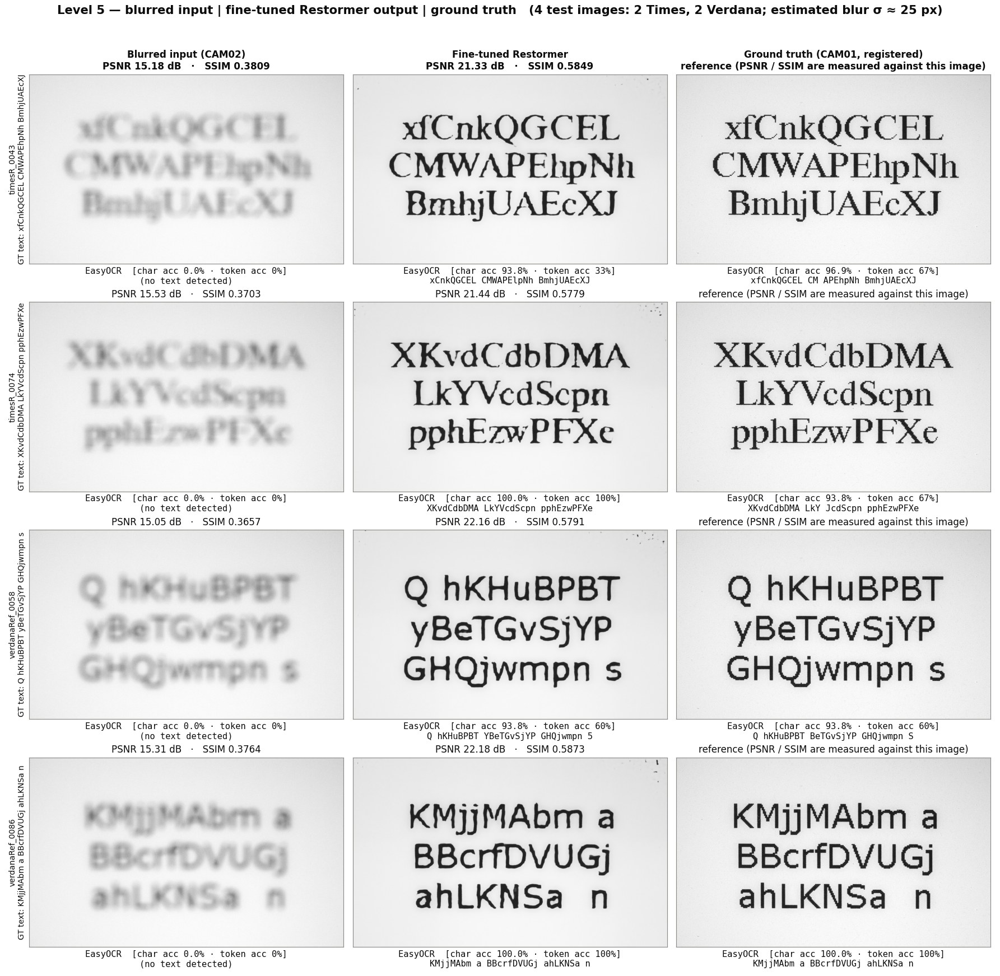

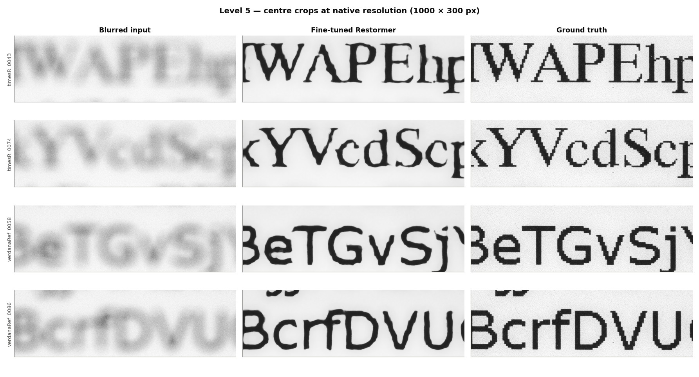

**Per-image metrics and OCR output for the four images shown**

| Image | Method | PSNR (dB) | SSIM | Char acc % | Token acc % | CER % | Ground-truth text | EasyOCR output |
|:--|:--|--:|--:|--:|--:|--:|:--|:--|
| timesR_0043 | Blurred input | 15.18 | 0.3809 | 0.0 | 0 | 100.0 | `xfCnkQGCEL CMWAPEhpNh BmhjUAEcXJ` | `(no text detected)` |
| timesR_0043 | Pretrained Restormer | 15.12 | 0.4254 | 0.0 | 0 | 100.0 | `xfCnkQGCEL CMWAPEhpNh BmhjUAEcXJ` | `(no text detected)` |
| timesR_0043 | Fine-tuned Restormer | 21.33 | 0.5849 | 93.8 | 33 | 6.2 | `xfCnkQGCEL CMWAPEhpNh BmhjUAEcXJ` | `xCnkQGCEL CMWAPElpNh BmhjUAEcXJ` |
| timesR_0043 | Sharp GT (upper bound) | — | — | 96.9 | 67 | 3.1 | `xfCnkQGCEL CMWAPEhpNh BmhjUAEcXJ` | `xfCnkQGCEL CM APEhpNh BmhjUAEcXJ` |
| timesR_0074 | Blurred input | 15.53 | 0.3703 | 0.0 | 0 | 100.0 | `XKvdCdbDMA LkYVcdScpn pphEzwPFXe` | `(no text detected)` |
| timesR_0074 | Pretrained Restormer | 15.48 | 0.4174 | 0.0 | 0 | 100.0 | `XKvdCdbDMA LkYVcdScpn pphEzwPFXe` | `(no text detected)` |
| timesR_0074 | Fine-tuned Restormer | 21.44 | 0.5779 | 100.0 | 100 | 0.0 | `XKvdCdbDMA LkYVcdScpn pphEzwPFXe` | `XKvdCdbDMA LkYVcdScpn pphEzwPFXe` |
| timesR_0074 | Sharp GT (upper bound) | — | — | 93.8 | 67 | 6.2 | `XKvdCdbDMA LkYVcdScpn pphEzwPFXe` | `XKvdCdbDMA LkY JcdScpn pphEzwPFXe` |
| verdanaRef_0058 | Blurred input | 15.05 | 0.3657 | 0.0 | 0 | 100.0 | `Q hKHuBPBT yBeTGvSjYP GHQjwmpn s` | `(no text detected)` |
| verdanaRef_0058 | Pretrained Restormer | 14.96 | 0.4126 | 0.0 | 0 | 100.0 | `Q hKHuBPBT yBeTGvSjYP GHQjwmpn s` | `(no text detected)` |
| verdanaRef_0058 | Fine-tuned Restormer | 22.16 | 0.5791 | 93.8 | 60 | 6.2 | `Q hKHuBPBT yBeTGvSjYP GHQjwmpn s` | `Q hKHuBPBT YBeTGvSjYP GHQjwmpn 5` |
| verdanaRef_0058 | Sharp GT (upper bound) | — | — | 93.8 | 60 | 6.2 | `Q hKHuBPBT yBeTGvSjYP GHQjwmpn s` | `Q hKHuBPBT BeTGvSjYP GHQjwmpn S` |
| verdanaRef_0086 | Blurred input | 15.31 | 0.3764 | 0.0 | 0 | 100.0 | `KMjjMAbm a BBcrfDVUGj ahLKNSa n` | `(no text detected)` |
| verdanaRef_0086 | Pretrained Restormer | 15.22 | 0.4248 | 0.0 | 0 | 100.0 | `KMjjMAbm a BBcrfDVUGj ahLKNSa n` | `(no text detected)` |
| verdanaRef_0086 | Fine-tuned Restormer | 22.18 | 0.5873 | 100.0 | 100 | 0.0 | `KMjjMAbm a BBcrfDVUGj ahLKNSa n` | `KMjjMAbm a BBcrfDVUGj ahLKNSa n` |
| verdanaRef_0086 | Sharp GT (upper bound) | — | — | 100.0 | 100 | 0.0 | `KMjjMAbm a BBcrfDVUGj ahLKNSa n` | `KMjjMAbm a BBcrfDVUGj ahLKNSa n` |


**Observations**

- **The headline level.** EasyOCR detects **no text at all** on any of the 40 blurred inputs or any of the 40 pretrained-Restormer outputs (0% accuracy, 100% empty outputs). After fine-tuning it reads 96.94% of characters and 75.0% of tokens, and 40% of images are transcribed perfectly.
- **Image metrics.** 15.35 → 21.98 dB (+6.63 dB), SSIM 0.372 → 0.582 (+0.210).
- **Legacy run.** Level 5 was trained first, with the earlier version of the notebook, before the Drive folder was reorganised. Its results sit one folder deeper (`level_05/results/level5_results/`), its `manifest.json` has no training configuration, and there is no `train_log.txt`. Blur σ ≈ 25 px comes from the notebook comment and from the combined-model preprocessing log; patch 128 × batch 4 follows from the notebook's rule for σ ≤ 30 and its comment that Level 5 used 128 × 4.

---

### 8.7 Level 6

| Item | Value |
|:--|:--|
| Dataset archive | `HDC2021_step6.zip` — 200 pairs (100 Times, 100 Verdana) |
| Split (same image IDs at every level) | 150 train / 10 validation / 40 test |
| Estimated blur σ | 30 px |
| Registration alignment score (NCC) | 0.758 before → 0.867 after (worst pair 0.849) |
| Global affine (input → GT) | scale x 1.0359, scale y 1.0362, shift (-37.1, -8.8) px |
| Initial weights | Original pretrained Restormer (`single_image_defocus_deblurring.pth`); no curriculum from other levels |
| Training patch × batch | 128 px × 4 |
| Iterations / learning rate | 3000 / 2e-5 (cosine decay to 1e-7) |
| Inference tiling | 768 px tiles, 192 px overlap |
| Best checkpoint | iteration 3000 — validation 20.19 dB / SSIM 0.5684 |
| Run date / wall time | 2026-10-19 / 45 min on a Tesla T4 |
| Checkpoints | `level_06/checkpoints/level6_best.pth` (104.7 MB, weights only), `level6_last.pth` (283.7 MB, with optimiser state) |


**Validation during training** (10 held-out images, full-image tiled inference)

| Iteration | 0 | 500 | 1000 | 1500 | 2000 | 2500 | 3000 |
|:--|--:|--:|--:|--:|--:|--:|--:|
| PSNR (dB) | 15.03 | 19.02 | 19.95 | 20.10 | 20.10 | 20.15 | 20.19 |
| SSIM | 0.4172 | 0.5575 | 0.5655 | 0.5674 | 0.5680 | 0.5683 | 0.5684 |


**Test-set results** (n = 40; mean ± standard deviation across images)

| Method | PSNR (dB) | SSIM | Char acc % | Char acc range % | Token acc % | CER % | WER % | Mean edit distance | Exact-match % | Empty OCR % |
|:--|--:|--:|--:|--:|--:|--:|--:|--:|--:|--:|
| Blurred input | 15.03 ± 0.42 | 0.3723 ± 0.0088 | 0.00 ± 0.00 | 0.0 – 0.0 | 0.00 | 100.00 | 100.00 | 31.90 | 0.0 | 100 |
| Pretrained Restormer | 15.05 ± 0.43 | 0.4174 ± 0.0097 | 0.00 ± 0.00 | 0.0 – 0.0 | 0.00 | 100.00 | 100.00 | 31.90 | 0.0 | 100 |
| Fine-tuned Restormer | 20.19 ± 0.53 | 0.5693 ± 0.0057 | 83.22 ± 8.75 | 59.4 – 96.9 | 32.00 | 16.78 | 78.83 | 5.35 | 0.0 | 0 |
| Sharp GT (upper bound) | — | — | 93.41 ± 5.78 | 78.1 – 100.0 | 69.12 | 6.59 | 38.67 | 2.10 | 20.0 | 0 |


Fine-tuned vs blurred input: **+5.16 dB PSNR, +0.1970 SSIM, +83.2 points character accuracy, +32.0 points token accuracy.** Fine-tuned vs pretrained: +5.14 dB, +0.1519 SSIM, +83.2 points character accuracy. Per image: PSNR improved on 40/40, SSIM on 40/40; character accuracy better / equal / worse than blurred on 40 / 0 / 0 images.

**By font**

| L | Method | Font | PSNR (dB) | SSIM | Char acc % | Token acc % | CER % | WER % |
|--:|:--|:--|--:|--:|--:|--:|--:|--:|
| 6 | Blurred input | timesR | 15.32 | 0.3766 | 0.00 | 0.00 | 100.00 | 100.00 |
| 6 | Blurred input | verdanaRef | 14.75 | 0.3680 | 0.00 | 0.00 | 100.00 | 100.00 |
| 6 | Pretrained Restormer | timesR | 15.35 | 0.4220 | 0.00 | 0.00 | 100.00 | 100.00 |
| 6 | Pretrained Restormer | verdanaRef | 14.75 | 0.4127 | 0.00 | 0.00 | 100.00 | 100.00 |
| 6 | Fine-tuned Restormer | timesR | 19.83 | 0.5683 | 78.52 | 23.92 | 21.48 | 92.75 |
| 6 | Fine-tuned Restormer | verdanaRef | 20.55 | 0.5703 | 87.91 | 40.08 | 12.09 | 64.92 |
| 6 | Sharp GT (upper bound) | timesR | — | — | 91.69 | 66.42 | 8.31 | 44.58 |
| 6 | Sharp GT (upper bound) | verdanaRef | — | — | 95.12 | 71.83 | 4.88 | 32.75 |


**Image comparison — blurred (left), fine-tuned (middle), ground truth (right)**

The four images are test-split positions 1, 11, 21 and 31 (two Times, two Verdana), chosen by position rather than by result. The same four image IDs are shown at every level.

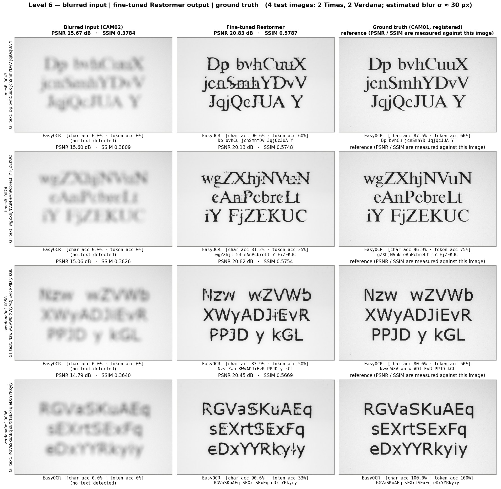

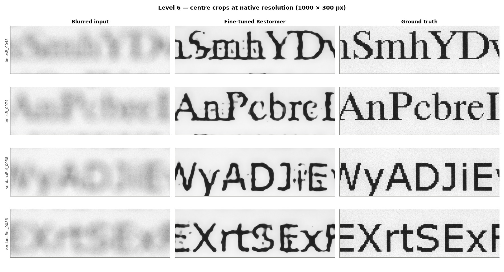

**Per-image metrics and OCR output for the four images shown**

| Image | Method | PSNR (dB) | SSIM | Char acc % | Token acc % | CER % | Ground-truth text | EasyOCR output |
|:--|:--|--:|--:|--:|--:|--:|:--|:--|
| timesR_0043 | Blurred input | 15.67 | 0.3784 | 0.0 | 0 | 100.0 | `Dp bvhCuuX jcnSmhYDvV JqjQcJUA Y` | `(no text detected)` |
| timesR_0043 | Pretrained Restormer | 15.72 | 0.4260 | 0.0 | 0 | 100.0 | `Dp bvhCuuX jcnSmhYDvV JqjQcJUA Y` | `(no text detected)` |
| timesR_0043 | Fine-tuned Restormer | 20.83 | 0.5787 | 90.6 | 60 | 9.4 | `Dp bvhCuuX jcnSmhYDvV JqjQcJUA Y` | `Dp bvhCu jcnSmhYDv JqjQcJUA Y` |
| timesR_0043 | Sharp GT (upper bound) | — | — | 87.5 | 60 | 12.5 | `Dp bvhCuuX jcnSmhYDvV JqjQcJUA Y` | `Dp bvhCu jcnSmhYD JqjQcJUA Y` |
| timesR_0074 | Blurred input | 15.60 | 0.3809 | 0.0 | 0 | 100.0 | `wgZXhjNVuN eAnPcbreLt iY FjZEKUC` | `(no text detected)` |
| timesR_0074 | Pretrained Restormer | 15.66 | 0.4288 | 0.0 | 0 | 100.0 | `wgZXhjNVuN eAnPcbreLt iY FjZEKUC` | `(no text detected)` |
| timesR_0074 | Fine-tuned Restormer | 20.13 | 0.5748 | 81.2 | 25 | 18.8 | `wgZXhjNVuN eAnPcbreLt iY FjZEKUC` | `wgZXhjl 53 eAnPcbreLt Y FiZEKUC` |
| timesR_0074 | Sharp GT (upper bound) | — | — | 96.9 | 75 | 3.1 | `wgZXhjNVuN eAnPcbreLt iY FjZEKUC` | `gZXhjNVuN eAnPcbreLt iY FjZEKUC` |
| verdanaRef_0058 | Blurred input | 15.06 | 0.3826 | 0.0 | 0 | 100.0 | `Nzw wZVWb XWyADJiEvR PPJD y kGL` | `(no text detected)` |
| verdanaRef_0058 | Pretrained Restormer | 15.05 | 0.4276 | 0.0 | 0 | 100.0 | `Nzw wZVWb XWyADJiEvR PPJD y kGL` | `(no text detected)` |
| verdanaRef_0058 | Fine-tuned Restormer | 20.82 | 0.5754 | 83.9 | 50 | 16.1 | `Nzw wZVWb XWyADJiEvR PPJD y kGL` | `Nzv Zwb KWyADJiEvR PPJD y kGL` |
| verdanaRef_0058 | Sharp GT (upper bound) | — | — | 80.6 | 50 | 19.4 | `Nzw wZVWb XWyADJiEvR PPJD y kGL` | `Nzw WZV Wb W ADJiEvR PPJD kGL` |
| verdanaRef_0086 | Blurred input | 14.79 | 0.3640 | 0.0 | 0 | 100.0 | `RGVaSKuAEq sEXrtSExFq eDxYYRkyiy` | `(no text detected)` |
| verdanaRef_0086 | Pretrained Restormer | 14.80 | 0.4090 | 0.0 | 0 | 100.0 | `RGVaSKuAEq sEXrtSExFq eDxYYRkyiy` | `(no text detected)` |
| verdanaRef_0086 | Fine-tuned Restormer | 20.45 | 0.5669 | 90.6 | 33 | 9.4 | `RGVaSKuAEq sEXrtSExFq eDxYYRkyiy` | `RGVaSKuAEq SEXrtSExFq eDx YRkyry` |
| verdanaRef_0086 | Sharp GT (upper bound) | — | — | 100.0 | 100 | 0.0 | `RGVaSKuAEq sEXrtSExFq eDxYYRkyiy` | `RGVaSKuAEq sEXrtSExFq eDxYYRkyiy` |


**Observations**

- **Clear drop from Level 5.** Character accuracy 83.22% (from 96.94% at Level 5) and token accuracy 32.0% (from 75.0%). No image is transcribed perfectly any more. The input is still completely unreadable (0%).
- **Image metrics.** 15.03 → 20.19 dB (+5.16 dB), SSIM +0.197.
- **A probable contributor: patch size.** σ ≈ 30 px sits exactly on the boundary of the notebook's rule, so Level 6 was trained with 128 px patches. A 128 px patch is only about 4σ wide, i.e. smaller than the blur's footprint (roughly ±2–3σ), so much of what the network needs to undo the blur lies outside the patch. Levels 7–9 use 192 px patches. Re-running Level 6 with `PATCH_OVERRIDE = (192, 2)` is a cheap experiment to check this.
- **Fonts diverge.** Times 78.5% vs Verdana 87.9% character accuracy; thin serif strokes are lost first.

---

### 8.8 Level 7

| Item | Value |
|:--|:--|
| Dataset archive | `HDC2021_step7.zip` — 200 pairs (100 Times, 100 Verdana) |
| Split (same image IDs at every level) | 150 train / 10 validation / 40 test |
| Estimated blur σ | 37 px |
| Registration alignment score (NCC) | 0.722 before → 0.836 after (worst pair 0.805) |
| Global affine (input → GT) | scale x 1.0430, scale y 1.0373, shift (-48.4, -2.9) px |
| Initial weights | Original pretrained Restormer (`single_image_defocus_deblurring.pth`); no curriculum from other levels |
| Training patch × batch | 192 px × 2 |
| Iterations / learning rate | 3000 / 2e-5 (cosine decay to 1e-7) |
| Inference tiling | 768 px tiles, 192 px overlap |
| Best checkpoint | iteration 2500 — validation 20.02 dB / SSIM 0.5667 |
| Run date / wall time | 2026-11-11 / 81 min on a Tesla T4 |
| Checkpoints | `level_07/checkpoints/level7_best.pth` (104.7 MB, weights only), `level7_last.pth` (283.7 MB, with optimiser state) |


**Validation during training** (10 held-out images, full-image tiled inference)

| Iteration | 0 | 500 | 1000 | 1500 | 2000 | 2500 | 3000 |
|:--|--:|--:|--:|--:|--:|--:|--:|
| PSNR (dB) | 14.80 | 18.53 | 19.45 | 19.71 | 19.95 | 20.02 | 20.02 |
| SSIM | 0.4150 | 0.5518 | 0.5606 | 0.5638 | 0.5659 | 0.5667 | 0.5666 |


**Test-set results** (n = 40; mean ± standard deviation across images)

| Method | PSNR (dB) | SSIM | Char acc % | Char acc range % | Token acc % | CER % | WER % | Mean edit distance | Exact-match % | Empty OCR % |
|:--|--:|--:|--:|--:|--:|--:|--:|--:|--:|--:|
| Blurred input | 14.71 ± 0.32 | 0.3729 ± 0.0077 | 0.00 ± 0.00 | 0.0 – 0.0 | 0.00 | 100.00 | 100.00 | 31.85 | 0.0 | 100 |
| Pretrained Restormer | 14.76 ± 0.33 | 0.4171 ± 0.0080 | 0.00 ± 0.00 | 0.0 – 0.0 | 0.00 | 100.00 | 100.00 | 31.85 | 0.0 | 100 |
| Fine-tuned Restormer | 19.87 ± 0.67 | 0.5665 ± 0.0056 | 77.04 ± 13.19 | 46.9 – 96.9 | 22.29 | 22.96 | 98.12 | 7.33 | 0.0 | 0 |
| Sharp GT (upper bound) | — | — | 91.63 ± 7.93 | 75.0 – 100.0 | 61.67 | 8.37 | 61.25 | 2.67 | 20.0 | 0 |


Fine-tuned vs blurred input: **+5.16 dB PSNR, +0.1936 SSIM, +77.0 points character accuracy, +22.3 points token accuracy.** Fine-tuned vs pretrained: +5.11 dB, +0.1494 SSIM, +77.0 points character accuracy. Per image: PSNR improved on 40/40, SSIM on 40/40; character accuracy better / equal / worse than blurred on 40 / 0 / 0 images.

**By font**

| L | Method | Font | PSNR (dB) | SSIM | Char acc % | Token acc % | CER % | WER % |
|--:|:--|:--|--:|--:|--:|--:|--:|--:|
| 7 | Blurred input | timesR | 14.93 | 0.3751 | 0.00 | 0.00 | 100.00 | 100.00 |
| 7 | Blurred input | verdanaRef | 14.50 | 0.3707 | 0.00 | 0.00 | 100.00 | 100.00 |
| 7 | Pretrained Restormer | timesR | 14.99 | 0.4192 | 0.00 | 0.00 | 100.00 | 100.00 |
| 7 | Pretrained Restormer | verdanaRef | 14.54 | 0.4149 | 0.00 | 0.00 | 100.00 | 100.00 |
| 7 | Fine-tuned Restormer | timesR | 19.33 | 0.5631 | 66.34 | 5.42 | 33.66 | 130.00 |
| 7 | Fine-tuned Restormer | verdanaRef | 20.42 | 0.5699 | 87.74 | 39.17 | 12.26 | 66.25 |
| 7 | Sharp GT (upper bound) | timesR | — | — | 87.95 | 53.33 | 12.05 | 86.25 |
| 7 | Sharp GT (upper bound) | verdanaRef | — | — | 95.30 | 70.00 | 4.70 | 36.25 |


**Image comparison — blurred (left), fine-tuned (middle), ground truth (right)**

The four images are test-split positions 1, 11, 21 and 31 (two Times, two Verdana), chosen by position rather than by result. The same four image IDs are shown at every level.

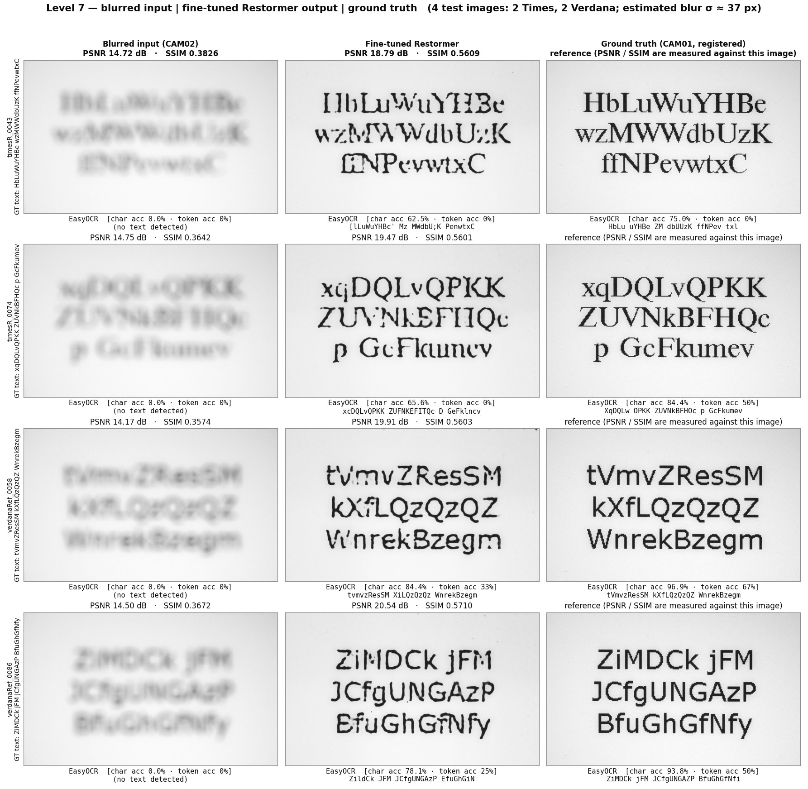

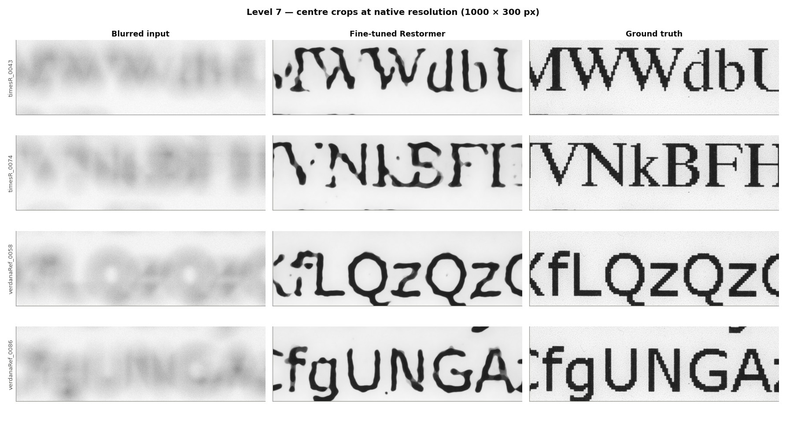

**Per-image metrics and OCR output for the four images shown**

| Image | Method | PSNR (dB) | SSIM | Char acc % | Token acc % | CER % | Ground-truth text | EasyOCR output |
|:--|:--|--:|--:|--:|--:|--:|:--|:--|
| timesR_0043 | Blurred input | 14.72 | 0.3826 | 0.0 | 0 | 100.0 | `HbLuWuYHBe wzMWWdbUzK ffNPevwtxC` | `(no text detected)` |
| timesR_0043 | Pretrained Restormer | 14.74 | 0.4258 | 0.0 | 0 | 100.0 | `HbLuWuYHBe wzMWWdbUzK ffNPevwtxC` | `(no text detected)` |
| timesR_0043 | Fine-tuned Restormer | 18.79 | 0.5609 | 62.5 | 0 | 37.5 | `HbLuWuYHBe wzMWWdbUzK ffNPevwtxC` | `[lLuWuYHBc' Mz MWdbU;K PenwtxC` |
| timesR_0043 | Sharp GT (upper bound) | — | — | 75.0 | 0 | 25.0 | `HbLuWuYHBe wzMWWdbUzK ffNPevwtxC` | `HbLu uYHBe ZM dbUUzK ffNPev txl` |
| timesR_0074 | Blurred input | 14.75 | 0.3642 | 0.0 | 0 | 100.0 | `xqDQLvQPKK ZUVNkBFHQc p GcFkumev` | `(no text detected)` |
| timesR_0074 | Pretrained Restormer | 14.79 | 0.4087 | 0.0 | 0 | 100.0 | `xqDQLvQPKK ZUVNkBFHQc p GcFkumev` | `(no text detected)` |
| timesR_0074 | Fine-tuned Restormer | 19.47 | 0.5601 | 65.6 | 0 | 34.4 | `xqDQLvQPKK ZUVNkBFHQc p GcFkumev` | `xcDQLvQPKK ZUFNKEFITQc D GeFklncv` |
| timesR_0074 | Sharp GT (upper bound) | — | — | 84.4 | 50 | 15.6 | `xqDQLvQPKK ZUVNkBFHQc p GcFkumev` | `XqDQLw OPKK ZUVNkBFHOc p GcFkumev` |
| verdanaRef_0058 | Blurred input | 14.17 | 0.3574 | 0.0 | 0 | 100.0 | `tVmvZResSM kXfLQzQzQZ WnrekBzegm` | `(no text detected)` |
| verdanaRef_0058 | Pretrained Restormer | 14.23 | 0.3998 | 0.0 | 0 | 100.0 | `tVmvZResSM kXfLQzQzQZ WnrekBzegm` | `(no text detected)` |
| verdanaRef_0058 | Fine-tuned Restormer | 19.91 | 0.5603 | 84.4 | 33 | 15.6 | `tVmvZResSM kXfLQzQzQZ WnrekBzegm` | `tvmvzResSM XiLQzQzQz WnrekBzegm` |
| verdanaRef_0058 | Sharp GT (upper bound) | — | — | 96.9 | 67 | 3.1 | `tVmvZResSM kXfLQzQzQZ WnrekBzegm` | `tVmvzResSM kXfLQzQzQZ WnrekBzegm` |
| verdanaRef_0086 | Blurred input | 14.50 | 0.3672 | 0.0 | 0 | 100.0 | `ZiMDCk jFM JCfgUNGAzP BfuGhGfNfy` | `(no text detected)` |
| verdanaRef_0086 | Pretrained Restormer | 14.55 | 0.4114 | 0.0 | 0 | 100.0 | `ZiMDCk jFM JCfgUNGAzP BfuGhGfNfy` | `(no text detected)` |
| verdanaRef_0086 | Fine-tuned Restormer | 20.54 | 0.5710 | 78.1 | 25 | 21.9 | `ZiMDCk jFM JCfgUNGAzP BfuGhGfNfy` | `ZildCk JFM JCfgUNGAzP EfuGhGiN` |
| verdanaRef_0086 | Sharp GT (upper bound) | — | — | 93.8 | 50 | 6.2 | `ZiMDCk jFM JCfgUNGAzP BfuGhGfNfy` | `ZiMDCk jFM JCfgUNGAZP BfuGhGfNfi` |


**Observations**

- **Still usable at character level, weak at word level.** 77.04% character accuracy, 22.3% token accuracy; PSNR +5.16 dB (14.71 → 19.87 dB), SSIM +0.194.
- **Training setup changes here.** σ ≈ 37 px triggers 192 px patches with batch 2, so the model sees 6,000 patches instead of 12,000 and each iteration takes about twice as long (81 min total vs ~45 min).
- **Strong font effect.** Times 66.3% vs Verdana 87.7% character accuracy.

---

### 8.9 Level 8

| Item | Value |
|:--|:--|
| Dataset archive | `HDC2021_step8.zip` — 200 pairs (100 Times, 100 Verdana) |
| Split (same image IDs at every level) | 150 train / 10 validation / 40 test |
| Estimated blur σ | 45 px |
| Registration alignment score (NCC) | 0.669 before → 0.804 after (worst pair 0.755) |
| Global affine (input → GT) | scale x 1.0524, scale y 1.0443, shift (-55.9, -4.5) px |
| Initial weights | Original pretrained Restormer (`single_image_defocus_deblurring.pth`); no curriculum from other levels |
| Training patch × batch | 192 px × 2 |
| Iterations / learning rate | 3000 / 2e-5 (cosine decay to 1e-7) |
| Inference tiling | 768 px tiles, 192 px overlap |
| Best checkpoint | iteration 3000 — validation 19.48 dB / SSIM 0.5635 |
| Run date / wall time | 2026-11-11 / 88 min on a Tesla T4 |
| Checkpoints | `level_08/checkpoints/level8_best.pth` (104.7 MB, weights only), `level8_last.pth` (283.7 MB, with optimiser state) |


**Validation during training** (10 held-out images, full-image tiled inference)

| Iteration | 0 | 500 | 1000 | 1500 | 2000 | 2500 | 3000 |
|:--|--:|--:|--:|--:|--:|--:|--:|
| PSNR (dB) | 14.43 | 17.32 | 18.66 | 19.28 | 19.44 | 19.47 | 19.48 |
| SSIM | 0.4577 | 0.5298 | 0.5541 | 0.5614 | 0.5631 | 0.5631 | 0.5635 |


**Test-set results** (n = 40; mean ± standard deviation across images)

| Method | PSNR (dB) | SSIM | Char acc % | Char acc range % | Token acc % | CER % | WER % | Mean edit distance | Exact-match % | Empty OCR % |
|:--|--:|--:|--:|--:|--:|--:|--:|--:|--:|--:|
| Blurred input | 14.45 ± 0.35 | 0.4173 ± 0.0082 | 0.00 ± 0.00 | 0.0 – 0.0 | 0.00 | 100.00 | 100.00 | 31.85 | 0.0 | 100 |
| Pretrained Restormer | 14.44 ± 0.34 | 0.4579 ± 0.0092 | 0.00 ± 0.00 | 0.0 – 0.0 | 0.00 | 100.00 | 100.00 | 31.85 | 0.0 | 100 |
| Fine-tuned Restormer | 19.47 ± 0.83 | 0.5629 ± 0.0068 | 73.47 ± 17.83 | 40.6 – 96.9 | 23.92 | 26.53 | 98.38 | 8.45 | 0.0 | 0 |
| Sharp GT (upper bound) | — | — | 92.62 ± 6.86 | 75.0 – 100.0 | 63.83 | 7.38 | 56.50 | 2.35 | 17.5 | 0 |


Fine-tuned vs blurred input: **+5.02 dB PSNR, +0.1456 SSIM, +73.5 points character accuracy, +23.9 points token accuracy.** Fine-tuned vs pretrained: +5.03 dB, +0.1050 SSIM, +73.5 points character accuracy. Per image: PSNR improved on 40/40, SSIM on 40/40; character accuracy better / equal / worse than blurred on 40 / 0 / 0 images.

**By font**

| L | Method | Font | PSNR (dB) | SSIM | Char acc % | Token acc % | CER % | WER % |
|--:|:--|:--|--:|--:|--:|--:|--:|--:|
| 8 | Blurred input | timesR | 14.66 | 0.4199 | 0.00 | 0.00 | 100.00 | 100.00 |
| 8 | Blurred input | verdanaRef | 14.24 | 0.4147 | 0.00 | 0.00 | 100.00 | 100.00 |
| 8 | Pretrained Restormer | timesR | 14.65 | 0.4604 | 0.00 | 0.00 | 100.00 | 100.00 |
| 8 | Pretrained Restormer | verdanaRef | 14.23 | 0.4554 | 0.00 | 0.00 | 100.00 | 100.00 |
| 8 | Fine-tuned Restormer | timesR | 18.75 | 0.5589 | 57.47 | 8.50 | 42.53 | 129.42 |
| 8 | Fine-tuned Restormer | verdanaRef | 20.19 | 0.5669 | 89.48 | 39.33 | 10.52 | 67.33 |
| 8 | Sharp GT (upper bound) | timesR | — | — | 91.37 | 60.17 | 8.63 | 70.83 |
| 8 | Sharp GT (upper bound) | verdanaRef | — | — | 93.88 | 67.50 | 6.12 | 42.17 |


**Image comparison — blurred (left), fine-tuned (middle), ground truth (right)**

The four images are test-split positions 1, 11, 21 and 31 (two Times, two Verdana), chosen by position rather than by result. The same four image IDs are shown at every level.

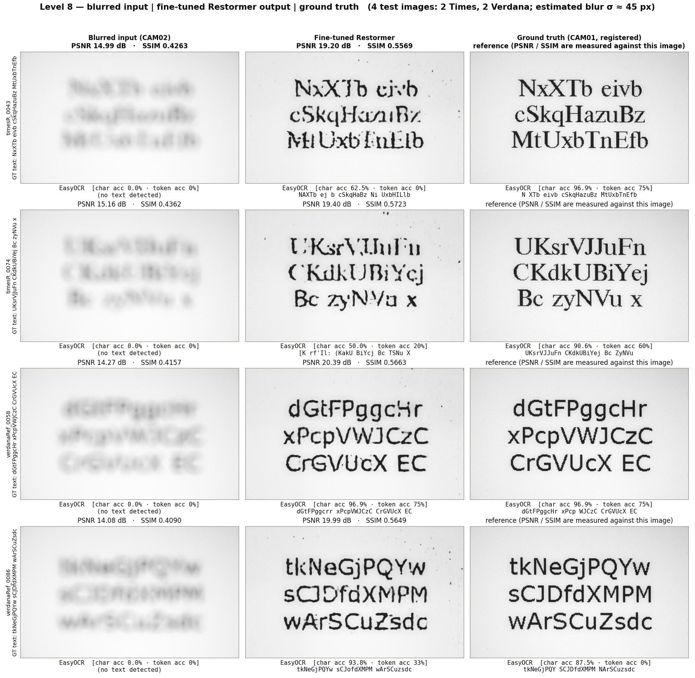

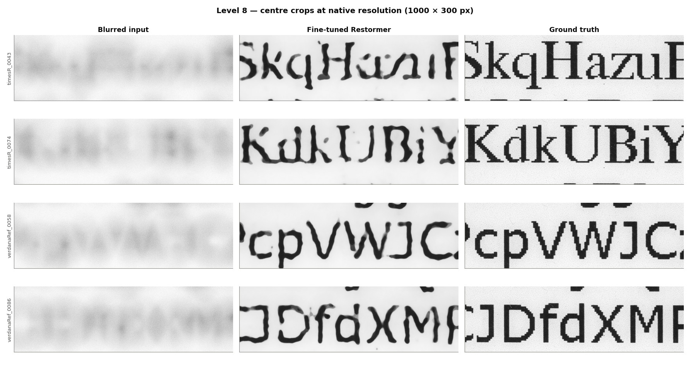

**Per-image metrics and OCR output for the four images shown**

| Image | Method | PSNR (dB) | SSIM | Char acc % | Token acc % | CER % | Ground-truth text | EasyOCR output |
|:--|:--|--:|--:|--:|--:|--:|:--|:--|
| timesR_0043 | Blurred input | 14.99 | 0.4263 | 0.0 | 0 | 100.0 | `NxXTb eivb cSkqHazuBz MtUxbTnEfb` | `(no text detected)` |
| timesR_0043 | Pretrained Restormer | 14.96 | 0.4669 | 0.0 | 0 | 100.0 | `NxXTb eivb cSkqHazuBz MtUxbTnEfb` | `(no text detected)` |
| timesR_0043 | Fine-tuned Restormer | 19.20 | 0.5569 | 62.5 | 0 | 37.5 | `NxXTb eivb cSkqHazuBz MtUxbTnEfb` | `NAXTb ej b cSkqHaBz Ni UxbHILlb` |
| timesR_0043 | Sharp GT (upper bound) | — | — | 96.9 | 75 | 3.1 | `NxXTb eivb cSkqHazuBz MtUxbTnEfb` | `N XTb eivb cSkqHazuBz MtUxbTnEfb` |
| timesR_0074 | Blurred input | 15.16 | 0.4362 | 0.0 | 0 | 100.0 | `UKsrVJJuFn CKdkUBiYej Bc zyNVu x` | `(no text detected)` |
| timesR_0074 | Pretrained Restormer | 15.12 | 0.4798 | 0.0 | 0 | 100.0 | `UKsrVJJuFn CKdkUBiYej Bc zyNVu x` | `(no text detected)` |
| timesR_0074 | Fine-tuned Restormer | 19.40 | 0.5723 | 50.0 | 20 | 50.0 | `UKsrVJJuFn CKdkUBiYej Bc zyNVu x` | `[K rf'Il: (KakU BiYcj Bc TSNu X` |
| timesR_0074 | Sharp GT (upper bound) | — | — | 90.6 | 60 | 9.4 | `UKsrVJJuFn CKdkUBiYej Bc zyNVu x` | `UKsrVJJuFn CKdkUBiYej Bc ZyNVu` |
| verdanaRef_0058 | Blurred input | 14.27 | 0.4157 | 0.0 | 0 | 100.0 | `dGtFPggcHr xPcpVWJCzC CrGVUcX EC` | `(no text detected)` |
| verdanaRef_0058 | Pretrained Restormer | 14.27 | 0.4562 | 0.0 | 0 | 100.0 | `dGtFPggcHr xPcpVWJCzC CrGVUcX EC` | `(no text detected)` |
| verdanaRef_0058 | Fine-tuned Restormer | 20.39 | 0.5663 | 96.9 | 75 | 3.1 | `dGtFPggcHr xPcpVWJCzC CrGVUcX EC` | `dGtFPggcrr xPcpVWJCzC CrGVUcX EC` |
| verdanaRef_0058 | Sharp GT (upper bound) | — | — | 96.9 | 75 | 3.1 | `dGtFPggcHr xPcpVWJCzC CrGVUcX EC` | `dGtFPggcHr xPcp WJCzC CrGVUcX EC` |
| verdanaRef_0086 | Blurred input | 14.08 | 0.4090 | 0.0 | 0 | 100.0 | `tkNeGjPQYw sCJDfdXMPM wArSCuZsdc` | `(no text detected)` |
| verdanaRef_0086 | Pretrained Restormer | 14.09 | 0.4496 | 0.0 | 0 | 100.0 | `tkNeGjPQYw sCJDfdXMPM wArSCuZsdc` | `(no text detected)` |
| verdanaRef_0086 | Fine-tuned Restormer | 19.99 | 0.5649 | 93.8 | 33 | 6.2 | `tkNeGjPQYw sCJDfdXMPM wArSCuZsdc` | `tkNeGjPQYw sCJofdXMPM wArSCuzsdc` |
| verdanaRef_0086 | Sharp GT (upper bound) | — | — | 87.5 | 0 | 12.5 | `tkNeGjPQYw sCJDfdXMPM wArSCuZsdc` | `tkNeGjPQY SCJDfdXMPM NArSCuzsdc` |


**Observations**

- **Similar to Level 7 on images, slightly lower on OCR.** 19.47 dB / 0.563 SSIM; 73.47% character accuracy and 23.9% token accuracy.
- **Font effect widens further.** Times 57.5% vs Verdana 89.5%. Verdana at Level 8 is read about as well as at Level 6–7; almost all of the loss is on the serif font.
- **Input SSIM is higher than at Level 7 (0.417 vs 0.373) although the blur is stronger.** The same jump appears for the pretrained model. SSIM against a noisy ground truth is dominated by background statistics rather than text here, so SSIM values should be compared within a level, not across levels (see §10).

---

### 8.10 Level 9

| Item | Value |
|:--|:--|
| Dataset archive | `HDC2021_step9.zip` — 200 pairs (100 Times, 100 Verdana) |
| Split (same image IDs at every level) | 150 train / 10 validation / 40 test |
| Estimated blur σ | 47 px |
| Registration alignment score (NCC) | 0.626 before → 0.780 after (worst pair 0.730) |
| Global affine (input → GT) | scale x 1.0573, scale y 1.0524, shift (-68.3, -8.5) px |
| Initial weights | Original pretrained Restormer (`single_image_defocus_deblurring.pth`); no curriculum from other levels |
| Training patch × batch | 192 px × 2 |
| Iterations / learning rate | 3000 / 2e-5 (cosine decay to 1e-7) |
| Inference tiling | 768 px tiles, 192 px overlap |
| Best checkpoint | iteration 2000 — validation 16.70 dB / SSIM 0.5286 |
| Run date / wall time | 2026-11-11 / 85 min on a Tesla T4 |
| Checkpoints | `level_09/checkpoints/level9_best.pth` (104.7 MB, weights only), `level9_last.pth` (283.7 MB, with optimiser state) |


**Validation during training** (10 held-out images, full-image tiled inference)

| Iteration | 0 | 500 | 1000 | 1500 | 2000 | 2500 | 3000 |
|:--|--:|--:|--:|--:|--:|--:|--:|
| PSNR (dB) | 14.38 | 15.48 | 15.44 | 15.12 | 16.70 | 15.88 | 16.12 |
| SSIM | 0.4583 | 0.4962 | 0.5025 | 0.4998 | 0.5286 | 0.5146 | 0.5197 |


**Test-set results** (n = 40; mean ± standard deviation across images)

| Method | PSNR (dB) | SSIM | Char acc % | Char acc range % | Token acc % | CER % | WER % | Mean edit distance | Exact-match % | Empty OCR % |
|:--|--:|--:|--:|--:|--:|--:|--:|--:|--:|--:|
| Blurred input | 14.39 ± 0.33 | 0.4192 ± 0.0059 | 0.00 ± 0.00 | 0.0 – 0.0 | 0.00 | 100.00 | 100.00 | 31.88 | 0.0 | 100 |
| Pretrained Restormer | 14.38 ± 0.32 | 0.4595 ± 0.0067 | 0.00 ± 0.00 | 0.0 – 0.0 | 0.00 | 100.00 | 100.00 | 31.88 | 0.0 | 100 |
| Fine-tuned Restormer | 16.81 ± 0.58 | 0.5310 ± 0.0080 | 52.82 ± 21.85 | 6.2 – 87.5 | 10.87 | 47.18 | 133.12 | 15.05 | 0.0 | 0 |
| Sharp GT (upper bound) | — | — | 93.24 ± 6.64 | 80.6 – 100.0 | 66.79 | 6.76 | 50.17 | 2.15 | 32.5 | 0 |


Fine-tuned vs blurred input: **+2.42 dB PSNR, +0.1118 SSIM, +52.8 points character accuracy, +10.9 points token accuracy.** Fine-tuned vs pretrained: +2.43 dB, +0.0715 SSIM, +52.8 points character accuracy. Per image: PSNR improved on 40/40, SSIM on 40/40; character accuracy better / equal / worse than blurred on 40 / 0 / 0 images.

**By font**

| L | Method | Font | PSNR (dB) | SSIM | Char acc % | Token acc % | CER % | WER % |
|--:|:--|:--|--:|--:|--:|--:|--:|--:|
| 9 | Blurred input | timesR | 14.60 | 0.4216 | 0.00 | 0.00 | 100.00 | 100.00 |
| 9 | Blurred input | verdanaRef | 14.17 | 0.4168 | 0.00 | 0.00 | 100.00 | 100.00 |
| 9 | Pretrained Restormer | timesR | 14.59 | 0.4619 | 0.00 | 0.00 | 100.00 | 100.00 |
| 9 | Pretrained Restormer | verdanaRef | 14.17 | 0.4571 | 0.00 | 0.00 | 100.00 | 100.00 |
| 9 | Fine-tuned Restormer | timesR | 16.55 | 0.5299 | 34.33 | 3.25 | 65.67 | 160.83 |
| 9 | Fine-tuned Restormer | verdanaRef | 17.06 | 0.5320 | 71.30 | 18.50 | 28.70 | 105.42 |
| 9 | Sharp GT (upper bound) | timesR | — | — | 90.26 | 54.08 | 9.74 | 74.67 |
| 9 | Sharp GT (upper bound) | verdanaRef | — | — | 96.22 | 79.50 | 3.78 | 25.67 |


**Image comparison — blurred (left), fine-tuned (middle), ground truth (right)**

The four images are test-split positions 1, 11, 21 and 31 (two Times, two Verdana), chosen by position rather than by result. The same four image IDs are shown at every level.

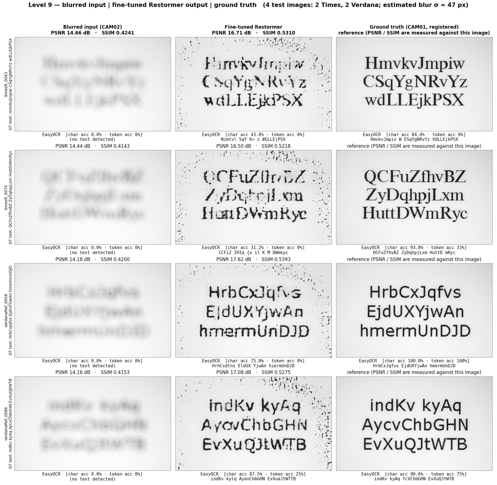

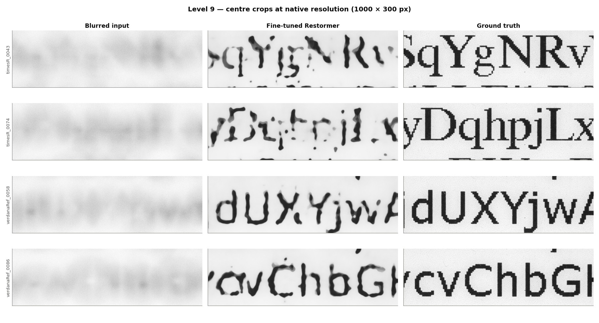

**Per-image metrics and OCR output for the four images shown**

| Image | Method | PSNR (dB) | SSIM | Char acc % | Token acc % | CER % | Ground-truth text | EasyOCR output |
|:--|:--|--:|--:|--:|--:|--:|:--|:--|
| timesR_0043 | Blurred input | 14.66 | 0.4241 | 0.0 | 0 | 100.0 | `HmvkvJmpiw CSqYgNRvYz wdLLEjkPSX` | `(no text detected)` |
| timesR_0043 | Pretrained Restormer | 14.64 | 0.4644 | 0.0 | 0 | 100.0 | `HmvkvJmpiw CSqYgNRvYz wdLLEjkPSX` | `(no text detected)` |
| timesR_0043 | Fine-tuned Restormer | 16.71 | 0.5310 | 43.8 | 0 | 56.2 | `HmvkvJmpiw CSqYgNRvYz wdLLEjkPSX` | `Nimtvl SqY K= z #GLLEjPSX` |
| timesR_0043 | Sharp GT (upper bound) | — | — | 84.4 | 0 | 15.6 | `HmvkvJmpiw CSqYgNRvYz wdLLEjkPSX` | `HmvkvJmpiv W ESqYgNRvYz VdLLEjkPSX` |
| timesR_0074 | Blurred input | 14.44 | 0.4143 | 0.0 | 0 | 100.0 | `QCFuZfhvBZ ZyDqhpjLxm HuttDWmRyc` | `(no text detected)` |
| timesR_0074 | Pretrained Restormer | 14.43 | 0.4535 | 0.0 | 0 | 100.0 | `QCFuZfhvBZ ZyDqhpjLxm HuttDWmRyc` | `(no text detected)` |
| timesR_0074 | Fine-tuned Restormer | 16.50 | 0.5218 | 31.2 | 0 | 68.8 | `QCFuZfhvBZ ZyDqhpjLxm HuttDWmRyc` | `CCFiZ IHIa {x il K M DWmkyc` |
| timesR_0074 | Sharp GT (upper bound) | — | — | 93.8 | 33 | 6.2 | `QCFuZfhvBZ ZyDqhpjLxm HuttDWmRyc` | `OCFuZfhvBZ ZyDqhpjLxm HuttD mRyc` |
| verdanaRef_0058 | Blurred input | 14.18 | 0.4200 | 0.0 | 0 | 100.0 | `HrbCxJqfvs EjdUXYjwAn hmermUnDJD` | `(no text detected)` |
| verdanaRef_0058 | Pretrained Restormer | 14.17 | 0.4596 | 0.0 | 0 | 100.0 | `HrbCxJqfvs EjdUXYjwAn hmermUnDJD` | `(no text detected)` |
| verdanaRef_0058 | Fine-tuned Restormer | 17.62 | 0.5393 | 75.0 | 0 | 25.0 | `HrbCxJqfvs EjdUXYjwAn hmermUnDJD` | `HrhCxdtns EldUX YjwAn hiermUnDJD` |
| verdanaRef_0058 | Sharp GT (upper bound) | — | — | 100.0 | 100 | 0.0 | `HrbCxJqfvs EjdUXYjwAn hmermUnDJD` | `HrbCxJqfvs EjdUXYjwAn hmermUnDJD` |
| verdanaRef_0086 | Blurred input | 14.16 | 0.4153 | 0.0 | 0 | 100.0 | `indKv kyAq AycvChbGHN EvXuQJtWTB` | `(no text detected)` |
| verdanaRef_0086 | Pretrained Restormer | 14.15 | 0.4551 | 0.0 | 0 | 100.0 | `indKv kyAq AycvChbGHN EvXuQJtWTB` | `(no text detected)` |
| verdanaRef_0086 | Fine-tuned Restormer | 17.08 | 0.5275 | 87.5 | 25 | 12.5 | `indKv kyAq AycvChbGHN EvXuQJtWTB` | `indKv kylq AyavChbGHN EvXuaJtWTTB` |
| verdanaRef_0086 | Sharp GT (upper bound) | — | — | 90.6 | 75 | 9.4 | `indKv kyAq AycvChbGHN EvXuQJtWTB` | `indKv kyAq YcVChbGHN EvXuQJtWTB` |


**Observations**

- **The method is near its limit.** PSNR gain falls to +2.42 dB (14.39 → 16.81 dB), SSIM +0.112, character accuracy 52.82% and token accuracy 10.9%. Every image still improves over the (completely unreadable) input.
- **Training was unstable.** Validation PSNR moved 15.48 → 15.44 → 15.12 → 16.70 → 15.88 → 16.12 dB across checkpoints and the best checkpoint (by SSIM) is iteration 2000, not the last one. The loss is still falling at iteration 3000 (0.0845), so the model is under-trained at this level.
- **Alignment is the weakest of all levels.** Mean alignment score 0.780, worst pair 0.730. With σ ≈ 47 px the registration itself is uncertain, which caps both the training signal and the measured PSNR.
- **Outputs show invented strokes.** In the close-up figure the Times outputs contain blobs and broken strokes that are not in the ground truth; Verdana remains partly legible (71.3% vs 34.3% for Times).

---


## 9. Discussion

### 9.1 Why the pretrained model fails and fine-tuning works

The official defocus weights were trained on natural photographs with mild, spatially varying defocus. Here the blur is a large uniform disc on black-on-white glyphs. With no fine-tuning the model changes the image very little: PSNR is at best 0.05 dB above the input (and up to 1.1 dB below it) and OCR accuracy is essentially unchanged. After 3000 iterations on 150 images the same network gains 2.4–8.4 dB. The first 500 iterations deliver most of that, which indicates the pretrained decoder is close to a useful solution and mainly needs to learn the blur scale and the glyph prior of this domain.

### 9.2 Why restored images can beat the sharp ground truth on OCR

EasyOCR reads the ground-truth images at only 90.8–94.1% character accuracy and 55–69% token accuracy. Its typical error on these images is dropping or splitting wide glyphs such as W and V in the large, high-contrast, slightly noisy camera rendering. The fine-tuned outputs at Levels 2–5 are smoother and noise-free, and are read at 96.1–98.3%. Two consequences: the "Sharp GT (upper bound)" row should be read as "how well this recogniser does on a clean camera image", and absolute OCR percentages are specific to EasyOCR's default models. A recogniser trained on this font size would shift all rows upward.

### 9.3 Why accuracy falls from Level 6

Three things change together as blur grows: (a) information is physically lost — strokes thinner than the blur disc leave almost no trace, which hits serif Times harder than uniform-stroke Verdana; (b) registration becomes less certain (alignment score 0.87 at Level 6, 0.78 at Level 9), so the training target is itself slightly misplaced; (c) the training patch covers fewer blur widths (128 px at σ ≈ 30 is about 4σ; 192 px at σ ≈ 47 is also about 4σ), while the patch count halves from Level 7. The step between Level 5 and Level 6 (96.9% → 83.2%) coincides with (c) at its tightest under the 128 px rule.

### 9.4 PSNR/SSIM and OCR measure different things

- Level 1 has the highest fine-tuned PSNR (28.87 dB) but a *negative* OCR change.
- Level 5 has a moderate PSNR (21.98 dB) and the largest OCR change (+96.9 points).
- Level 8 input SSIM (0.417) is higher than Level 4 input SSIM (0.373) although Level 8 is far more blurred.

Image metrics are computed against a noisy, imperfectly registered camera image, so they saturate low (best SSIM ≈ 0.69) and reward matching background statistics. For a recognition-oriented project the OCR columns are the primary outcome; PSNR/SSIM are best used *within* a level to compare methods.

### 9.5 What the per-level design does and does not show

Each model is trained and tested on one blur level, so these results describe the **non-blind, level-matched** case: the blur level is known and a matching model is applied. They do not show how a model behaves on a level it was not trained on. The planned combined model (§11) is the experiment that addresses blind deblurring across levels.

---

## 10. Limitations and caveats

1. **Level 0 OCR is missing** from the export; its image metrics were recomputed for this report.
2. **Level 5 is a legacy run** with an incomplete manifest and no text log; its patch/batch setting is inferred from the notebook.
3. **σ estimates are coarse** (5 px grid) and Levels 0–2 sit on the grid minimum.
4. **One run per level, one seed.** No repeated runs, so there are no confidence intervals across trainings; the ± values in the tables are spread across the 40 test images.
5. **Small validation set** (10 images) for checkpoint selection; at Level 9 the selected checkpoint (iteration 2000) differs noticeably from its neighbours.
6. **Different patch/batch settings** for Levels 0–6 and 7–9 mean the levels are not trained under strictly identical budgets (12,000 vs 6,000 patches).
7. **Same fonts, same size, same display** in train and test. The text strings differ, but generalisation to other fonts, sizes or real documents is untested.
8. **Single recogniser.** All OCR numbers are EasyOCR with default models; token accuracy ignores word order and line breaks.
9. **Image metrics depend on registration**, which degrades with blur; part of the PSNR drop at high levels is measurement, not restoration.
10. **Ground truth is a camera image, not a rendered glyph**, so it contains sensor noise that a good restoration will (correctly) not reproduce; this caps SSIM.
11. **Earlier Phase-1 figures** (small "focusStep" subset, levels 0–4, different split and notebook) are not comparable with the numbers in this report and are superseded by it for those levels.

---

## 11. Level 10 and the combined "ultimate" model

**Level 10.** `HDC2021_step_10.zip` is in the folder and `level_10/manifest.json` reads *"pending - dataset not uploaded yet"*. No per-level training was run.

**Combined model.** `ultimate_model/` holds the start of a single model trained on Levels 5–10 together:

| Item | Value (from `ultimate_model/logs/train_log.txt` and `preprocessing_summary.csv`) |
|:--|:--|
| Start | 20 October 2026, Tesla T4 |
| Levels | 5, 6, 7, 8, 9, 10 — 200 pairs each, 150 / 10 / 40 split per level |
| Registration | Per-level global affine plus per-image refinement where it helped (87 images at Level 5, 20 at Level 6, none above) |
| Progressive patch stages | (until iteration 2500: 160 px, batch 4), (until 5000: 224 px, batch 2), (until 6000: 288 px, batch 2) |
| Learning rate | 8e-5, encoder at half that rate (encoder not frozen) |
| Pretrained baseline at iteration 0 | Validation 14.78 dB / SSIM 0.4396 (per level SSIM: L5 0.422, L6 0.417, L7 0.415, L8 0.457, L9 0.458, L10 0.469) |
| What exists | `checkpoints/ultimate_last.pth` (418.8 MB), registration cache, splits, one data-check figure |
| What does not exist | No best checkpoint, no validation lines after iteration 0, no metrics, no restored images |

| Level | Blur σ (px) | Matches | RANSAC inliers | NCC before | NCC after |
|--:|--:|--:|--:|--:|--:|
| 5 | 25 | 2950 | 1581 | 0.792 | 0.892 |
| 6 | 30 | 2834 | 915 | 0.758 | 0.867 |
| 7 | 37 | 2584 | 485 | 0.722 | 0.836 |
| 8 | 45 | 2405 | 249 | 0.669 | 0.804 |
| 9 | 47 | 2060 | 148 | 0.626 | 0.780 |
| 10 | 55 | 1745 | 82 | 0.559 | 0.689 |

The log stops immediately after the first training stage begins, so this model has to be treated as **not yet trained/evaluated**. The inlier counts confirm the registration trend from §5.4: at Level 10 only 82 of 1745 matches agree with a single affine.

---

## 12. How to reproduce or extend

1. Put `HDC2021_stepN.zip` in `FinalYearProject-Phase2/level_NN/dataset/` on Drive and keep `pretrained/single_image_defocus_deblurring.pth` in place.
2. Open the notebook in Colab with a T4 GPU, set `LEVEL = N` in the first cell, leave `INIT_FROM = 'pretrained'`, and *Run all*. A level takes about 45 minutes of training at 128 × 4 and about 85 minutes at 192 × 2, plus registration, baseline inference and OCR.
3. Outputs appear under `level_NN/`: checkpoints, `results/` (split, registration, CSVs, OCR transcripts, restored PNGs, figures), `logs/`, and an updated `manifest.json`.
4. The last cell rebuilds `all_levels_summary.csv` and `all_levels_trend.png` from every level that has a summary.

Suggested next runs, in order of expected value:

- **Level 0 OCR:** re-run the evaluation cells for Level 0 (the checkpoint and split exist; `RESUME=True` skips training) to fill the missing row.
- **Level 6 with `PATCH_OVERRIDE = (192, 2)`** to test the patch-size explanation in §9.3.
- **Level 9 with more iterations** (the loss has not converged) and/or `INIT_FROM = 'previous'` (start from Level 8's best checkpoint).
- **Level 10** per-level run for completeness.
- **Cross-level test:** apply each level's checkpoint to the neighbouring levels' test sets to quantify how blind the per-level models are.
- **Finish and evaluate the combined model.**
- **A second recogniser** (for example TrOCR, already used elsewhere in the project) to check that the OCR conclusions do not depend on EasyOCR.

---

## 13. Appendix

### 13.1 Files produced with this report

| Path | Content |
|:--|:--|
| `REPORT.md` / `REPORT.docx` / `REPORT.pdf` / `REPORT.html` | This report |
| `PROJECT_CONTEXT.md` | Self-contained context file for a reader or LLM with no prior knowledge |
| `tables/COMPARISON_TABLES.md` | All comparison tables in one Markdown file |
| `tables/all_levels_summary_extended.csv` | Mean, standard deviation, min and max of every metric per level and method |
| `tables/all_levels_per_image_metrics.csv` | Every test image × method: PSNR, SSIM, character/token accuracy, CER, WER, GT text, OCR text |
| `tables/all_levels_by_font.csv` | Per-font means |
| `tables/gains_fine_tuned.csv` | Gains and per-image win/tie/loss counts |
| `tables/training_and_registration_by_level.csv` | Blur σ, patch/batch, validation start/best, loss, wall time, registration quality, affine |
| `tables/all_levels_ocr_outputs.csv` | All 1,440 OCR transcripts with error metrics |
| `comparisons/level_NN_comparison.jpg` | 4 × 3 grid: blurred, fine-tuned, ground truth, with metrics and OCR text |
| `comparisons/level_NN_closeup.jpg` | Centre crops of the same images at native resolution |
| `images/level_NN/` | Individual full-resolution panels (blurred, pretrained, fine-tuned, ground truth) for the four displayed images |
| `figures/` | Architecture diagram (PNG and SVG), block detail, pipeline, charts |
| `source_results/` | Copies of the original per-level CSVs, logs, manifests and notebook figures from the Drive export |
| `scripts/` | The Python scripts that produced the tables and figures |

### 13.2 Glossary

- **CAM01 / CAM02** — the in-focus and the defocused camera; ground truth and input.
- **Focus step / level** — one defocus setting of CAM02 in HDC 2021; higher is blurrier.
- **σ (blur sigma)** — width of the Gaussian that best mimics the level's blur for matching purposes.
- **NCC** — normalised cross-correlation, the alignment score (1 = identical up to brightness/contrast).
- **MDTA / GDFN** — the attention and feed-forward sub-layers of a Restormer block (§4.2).
- **Charbonnier loss** — smooth approximation of the absolute error.
- **AMP** — automatic mixed precision (float16 forward pass).
- **CER / WER** — character / word error rate.

### 13.3 References

- S. W. Zamir, A. Arora, S. Khan, M. Hayat, F. S. Khan, M.-H. Yang. *Restormer: Efficient Transformer for High-Resolution Image Restoration.* CVPR 2022. Code and weights: github.com/swz30/Restormer.
- M. Juvonen, S. Siltanen, F. Silva de Moura. *Helsinki Deblur Challenge 2021: description of photographic data.* 2021 (dataset on Zenodo).
- JaidedAI. *EasyOCR.* github.com/JaidedAI/EasyOCR.
